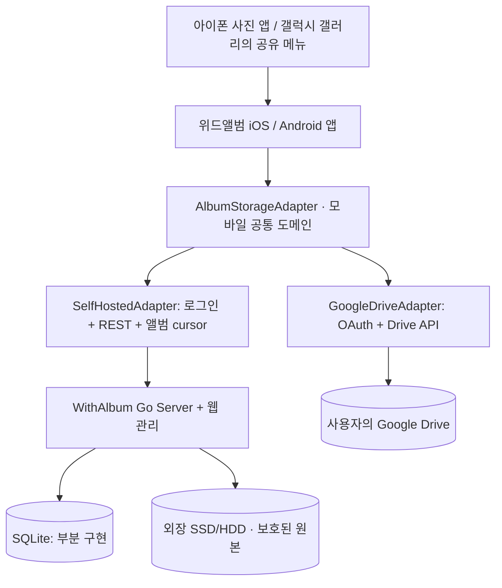

# 위드앨범 · WithAlbum

> **내 사진과 앨범을, 내가 선택한 저장소에.**  
> *Self-hosted photo sharing for Mac mini first, Linux/Raspberry Pi later; optional serverless Google Drive mode.*

<!-- WITHALBUM 문서 주석 사용법:
이 README는 사람에게 보이는 설명과, Claude 같은 개발 에이전트를 위한 HTML 주석을 함께 포함한다.
주석도 설계의 일부다. 주석의 '목표/검증/금지'는 개발 요구사항이지 이미 구현된 코드라는 뜻이 아니다.
대화에서 확정된 내용은 v1.4 설계 + 본 문서의 정리본으로 확인한다.
결정의 유래는 docs/DECISIONS_v1.5.md에 정리되어 있다.
읽기 순서: README.md -> CLAUDE.md -> docs/PRODUCT_ARCHITECTURE_v1.4.md -> docs/ACCESS_CONTROL_v1.4.md -> 기존 코드와 테스트.
-->

## ⛔ 현재 상태를 먼저 확인하세요

**이 저장소는 완성 앱이 아니라 개발용 서버 프로토타입 + 전체 제품 설계 + Claude 개발 인수인계 패키지입니다.**

- **기능이 동작하는 코드:** Go 기반 localhost 전용 서버, 간단한 웹 페이지, 폴더 생성, 파일 업로드, SHA-256 중복 확인, 제한적인 이미지 프리뷰, 변경 이벤트 조회.
- **부분 구현(실기기 미검증):** `internal/storage/` 저장소 볼륨 가드. 명시적으로 `-init-storage`한 디렉터리만 사용하고, 기동 시와 쓰기 직전에 볼륨 마커·장치 번호(st_dev)를 재확인해 외장 디스크가 빠지면 쓰기를 거부(503)합니다. 디스크 UUID 대조는 아직 없음.
- **부분 구현:** 메타데이터는 SQLite(`.system/withalbum.db`, `internal/meta/sqlitestore`)에 저장합니다. 업로드 1건(blob·자산·폴더 연결·시퀀스·이벤트)은 트랜잭션 하나로 커밋되고, 자산 ID는 랜덤이며 폴더마다 따로 발급됩니다(같은 바이트라도 다른 폴더에서는 다른 자산). 새 폴더의 소유자는 만든 사람이고, 이전 버전·이관 데이터의 폴더는 bootstrap 관리자 계정이 소유합니다(처음에는 로그인할 수 없는 잠금 상태의 `admin`, 콘솔 `withalbum-server admin init`으로 인수하면 user_id가 유지되어 그 폴더를 그대로 소유). **이전 버전의 `.system/state.json`만 있는 저장소는 기동을 거부합니다(파일은 변경하지 않음). `withalbum-server migrate-legacy`(점검) → `migrate-legacy -apply`로 무손실 이관한 뒤 기동하세요. 절차·롤백: [`docs/MIGRATION_legacy_state.md`](docs/MIGRATION_legacy_state.md).**
- **부분 구현(테스트 검증, 실기기 미검증):** 업로드 원자적 커밋·크래시 복구. 성공 응답(200/201)은 원본 파일(임시 파일 fsync → pool rename → 디렉터리 fsync)과 DB 트랜잭션이 모두 디스크에 기록된 뒤에만 보냅니다. 기동 시 재조정이 미완료 업로드 임시 파일을 지우고, DB에 없는 pool 파일은 `.system/orphans/`로 옮기며(삭제 안 함), DB에 있는데 파일이 없거나 크기가 다른 원본은 로그와 `/api/v1/health`의 `integrity: warning`으로 알립니다. 여유 공간이 예약분(`WITHALBUM_MIN_FREE_BYTES`, 기본 1GiB) 아래로 내려갈 업로드는 기록 전에 `507 insufficient_storage`로 거부합니다. 같은 저장소에 서버/이관 명령이 두 개 뜨지 않도록 `.system/withalbum.lock`을 잠급니다. 단계별 장애 주입과 실제 SIGKILL 테스트로 검증했고, 실제 전원 차단·외장 디스크 분리는 미검증입니다.
- **부분 구현:** 계정 코어. Argon2id 비밀번호 해시(`internal/auth/password`), 사용자 저장소(`internal/users`, 마지막 활성 관리자 보호·감사 로그), 콘솔 명령 `withalbum-server admin init | create-user | reset-password`.
- **부분 구현(테스트·로컬 바이너리 스모크 검증, Mac 브라우저 점검 전):** 설치 화면(M24). 저장소가 없거나 관리자가 없으면 서버가 **이 컴퓨터의 평문 루프백 리스너에서만** 설치 모드로 뜨고, 콘솔에 1회용 설치 코드(12자, 30분, 5회 오입력 시 잠김)를 출력합니다. 브라우저 `http://127.0.0.1:8787/setup`에서 코드 → 저장장치 선택(macOS `/Volumes`·홈 폴더·직접 경로, 쓰기 테스트) → 관리자 계정 → 같은 프로세스에서 정상 모드로 전환(설치 라우트 404). 선택한 루트와 볼륨 ID는 사용자 설정 파일(`WITHALBUM_CONFIG`, 기본 `~/Library/Application Support/WithAlbum/server.json`)에 고정됩니다. TLS·LAN 리스너에는 설치 라우트가 없고, 콘솔 경로(`-init-storage`, `admin init`)는 그대로입니다. 위협 모델: [`SECURITY.md`](SECURITY.md#setup-screen-m24-threat-model).
- **부분 구현:** HTTP 로그인·기기 세션·계정 관리 API(`/api/v1/auth/login|refresh|logout`, `/api/v1/me`, `/api/v1/me/password`, `/api/v1/me/devices`, `/api/v1/admin/users*`, 규격 [`docs/API_v2.yaml`](docs/API_v2.yaml)). access 15분/refresh 30일 회전(로그인 후 최대 90일)·재사용 감지(앱 응답 유실 30초 유예 1회), Bearer(앱)·HttpOnly 쿠키+CSRF(웹), 로그인 속도 제한·실패 감사, 비밀번호 재설정·계정 비활성화 시 세션 회수.
- **부분 구현(테스트·로컬 바이너리 스모크 검증):** 앨범 ACL. 대시보드 페이지·health·login·refresh를 뺀 모든 API는 세션 필요(없으면 401). 폴더·업로드·동기화·원본/프리뷰는 요청마다 DB의 소유자·멤버십으로 `internal/authz` 판정(`internal/httpapi/middleware_authz.go`, 라우트별 정책 표, 미선언 라우트는 기동 시 panic). 관리자라도 소유·멤버가 아닌 앨범은 404, 역할 부족은 403, 다른 폴더의 자산 ID는 404. UPLOADER는 업로드만 가능하고 응답은 항상 같은 202 영수증. 업로드는 커밋 직전 DB 트랜잭션 안에서 권한을 재확인. 기본 USER는 앨범 생성 불가(`can_create_albums`). 무인증 `/api/v1/assets/{sha}/*`는 제거. 앨범 공유(OWNER만): 등록 계정 초대(7일, 대상 본인만 수락), 초대 취소, 역할 변경·추방(다음 요청부터 반영), 소유권 이전(이전 오너는 CONTRIBUTOR, 1 트랜잭션, 실패 시 롤백), 앨범 보관. 모든 변경은 같은 트랜잭션에서 감사 로그. 관리자는 **보관된 앨범만** 다른 활성 계정에 재배정할 수 있음(탈퇴 계정 비활성화용, 접근 권한은 생기지 않음, M17).
- **설계만 완료:** Mac 설치 마법사, iOS/Android 앱, 역방향 모바일 동기화, Google Drive 어댑터, 장애 복구.
- **아직 없음:** 서명·공증된 DMG, 정식 Google Drive OAuth 연결, 모바일 앱, 프로덕션 안정성 보장.
- **부분 구현(테스트·LAN 바이너리 스모크 검증, 실기기 앱 미검증):** TLS·LAN 게이트(M15). 기본은 `127.0.0.1` 평문 HTTP. LAN 주소(사설 IP 또는 와일드카드)는 `-allow-lan` + `-tls` + 로그인 가능한 활성 SERVER_ADMIN이 모두 있을 때만 listen하고, 하나라도 없으면 기동을 거부합니다. 공인 IP·호스트 이름은 항상 거부. `-tls`는 자체 서명 인증서(`.system/tls/server.pem`, 0600, ECDSA P-256, TLS 1.3 전용)를 만들고, 앱은 공개키 지문(SPKI SHA-256)을 핀닝합니다(`withalbum-server tls`, 대시보드 관리자 화면에 페어링 페이로드). 보안 헤더·원본 다운로드 sandbox·IPv6 /64 속도 제한 키·루프백 Host 검사. 자세한 내용과 보안 점검 결과: [`SECURITY.md`](SECURITY.md).
- **보안 경고:** **인터넷에 공개(포트포워딩·공개 리버스 프록시)하거나 대체할 수 없는 원본 사진의 단일 보관소로 사용하지 마세요.**

<!-- 구현 범위 확인:
internal/meta/sqlitestore: 서버가 쓰는 메타데이터 저장소. internal/meta/jsonstore는 서버 기동에 쓰이지 않는다(이관 테스트에서 이전 버전 데이터를 만드는 용도). 이관은 internal/legacyimport가 state.json을 자체 엄격 파서로 읽는다. 단일 요청 업로드 MAX 512MiB, 그보다 큰 원본은 재개 가능한 업로드 세션(M22, 최대 64GiB).
internal/httpapi: API 자산 ID는 랜덤 assets.asset_id(폴더별). SHA-256은 업로드 중복 제거·다운로드 검증용 sha256 필드로만 노출(읽기 권한자에게만). 라우트 보호는 middleware_authz.go의 routePolicies가 단일 출처다. 업로더는 세션의 user_id로 기록(assets.uploaded_by_user_id, folder_assets.added_by_user_id).
server/listen.go: non-loopback listen은 -allow-lan + -tls + 사용 가능한 SERVER_ADMIN 모두 필요(checkListen). 평문 HTTP는 loopback만. 이 조건을 완화하지 말 것.
SQLite 스키마와 YAML API 문서는 목표 규격으로만 분류할 것. 결과/HTTP 응답이 현재 구현과 다를 수 있다.
이 패키지는 'v1.5 documentation/handoff'이고 서버 실행파일 기능이 v1.5로 향상되었다는 뜻이 아님.
-->

## 📦 다운로드 · GitHub Releases · 릴리스 노트

> **현재 이 패키지의 ZIP이 개발 인수인계용 원본입니다.** 아직 GitHub 저장소와 정식 Release URL은 정해지지 않았습니다.

| 항목 | 안내 | 현재 상태 |
|---|---|---|
| [GitHub 최신 다운로드](../../releases/latest) | 저장소에 올린 뒤 태그 릴리스 발행 시 활성화되는 상대 링크 | **미게시** |
| [GitHub 모든 버전·릴리스 노트](../../releases) | 버전별 변경 내용과 설치 파일 | **미게시** |
| [Mac mini 설치](docs/INSTALL_MACOS.md) | Apple Silicon(`darwin_arm64`) 최우선; Intel도 목표 | 개발자용 CLI/LaunchAgent |
| [Linux·Raspberry Pi 설치](docs/INSTALL_LINUX.md) | Linux AMD64/ARM64/ARMv7, systemd | 개발자용 |
| [배포 파이프라인](docs/RELEASING.md) | GitHub Actions · GoReleaser · checksum · `scripts/release-dryrun.sh` | prerelease(초안)만, dry-run 검증 |
| [v0.1.0-alpha.1 릴리스 노트](docs/releases/v0.1.0-alpha.1.md) | 첫 prerelease 후보 | **초안, 미발행** |
| [Mac mini 실기기 점검](docs/MACMINI_E2E_CHECKLIST.md) | 설치·자동 시작·디스크 분리·재부팅·전원 차단·백업·LAN TLS | 절차만, 실기기 결과 없음 |

<!-- 릴리스 요구사항:
GitHub Releases는 git의 'release/' 폴더가 아니라 GitHub Releases 화면이다.
파일 명명, checksums.txt, 릴리스 노트, prerelease 표시, 설치 방법, 지원 아키텍처를 매번 검증한다.
고객용 Mac DMG/PKG는 아직 존재하지 않으므로 README에서 다운로드 가능하다고 적지 않는다.
실제 리포지터리가 만들어지면 GitHub URL, go.mod placeholder, workflow 동작, README 링크를 갱신한다.
미서명 바이너리와 실제 Mac 실기기 테스트 여부를 명시한다.
-->

### Known limitations (알려진 제약, v0.1.0-alpha.1 기준)

- **실험판(prerelease)**입니다. 인터넷 공개 금지, 대체 불가능한 원본의 유일한 보관소로 쓰지 말 것. alpha 동안 데이터 형식·API가 바뀔 수 있습니다.
- **실기기 미검증:** Mac mini + 외장 디스크에서의 설치·launchd 자동 시작·디스크 분리/재연결·재부팅·전원 차단·백업 복원은 절차([`docs/MACMINI_E2E_CHECKLIST.md`](docs/MACMINI_E2E_CHECKLIST.md))만 있고 결과가 없습니다. Intel Mac·Linux·Raspberry Pi는 크로스빌드만 확인했습니다.
- macOS 바이너리는 **서명·공증되지 않은 ZIP**입니다. DMG/PKG, 메뉴바 앱, 로그인 전 상시 실행(시스템 서비스)은 없습니다. `scripts/install-macos.sh`의 LaunchAgent는 사용자가 로그인한 세션에서만 동작합니다.
- 외장 디스크를 다시 연결했을 때 장치 번호(st_dev)가 바뀌면 서버를 재시작해야 쓰기가 재개될 수 있습니다(fail closed 유지). 디스크 UUID 대조는 없고, 볼륨 마커를 복사한 다른 디스크는 구분하지 못할 수 있습니다.
- 백업은 수동 명령(`backup -to`)뿐입니다. 예약 실행·원격/클라우드 백업·보존 정책은 없습니다.
- LAN은 자체 서명 TLS + 공개키 지문 핀만 지원합니다(브라우저 경고). 앱의 핀닝은 실기기에서 검증하지 않았습니다. 인터넷 접속·원격 중계는 없습니다.
- HEIC·영상 미리보기는 `sips`/`ffmpeg`가 있을 때만 만들어집니다(없으면 원본만 보관, `unsupported`). Linux 외부 도구는 미검증입니다.
- 모바일 앱, Google Drive 모드, 실시간 푸시, 초대 거절·자진 탈퇴·보관 복원은 없습니다.
- 원본 다운로드의 416 응답 본문은 JSON 오류 객체가 아닌 짧은 text/plain입니다(`docs/API_v2.yaml`).

### 프로젝트 최상위 실행 명령

Go 1.26+에서 테스트용 파일로만 확인하세요.

```bash
go test ./...
go vet ./...
go build -o withalbum-server ./server
mkdir -p "$HOME/WithAlbumTest"                                   # 저장소 루트는 직접 만든다
WITHALBUM_ROOT="$HOME/WithAlbumTest" ./withalbum-server -init-storage  # 최초 1회: 볼륨 마커 등록
WITHALBUM_ROOT="$HOME/WithAlbumTest" ./withalbum-server
# 같은 컴퓨터 브라우저: http://127.0.0.1:8787
```

**설치 화면으로 시작하기(M24, 이 Mac에서만):** `WITHALBUM_ROOT` 없이 `./withalbum-server`를 실행하면, 등록된 저장소가 없을 때 설치 모드로 뜨고 콘솔에 `SETUP: open http://127.0.0.1:8787/setup ... setup code XXXX-XXXX-XXXX`를 출력합니다. 같은 컴퓨터 브라우저에서 그 주소를 열고 코드를 입력한 뒤 저장장치와 관리자 계정을 정하면, 서버는 재시작 없이 일반 대시보드로 바뀝니다. 선택한 저장 폴더는 사용자 설정 파일에 기록되어 다음 기동과 콘솔 명령이 같은 저장소를 씁니다(`WITHALBUM_ROOT`가 있으면 그것이 우선, 설정 파일의 루트가 없으면 설치 모드로 가지 않고 종료). 설치 화면이 만드는 폴더는 사용자가 고른 디스크(또는 홈 폴더) 바로 아래 `WithAlbum` 하나뿐이며, 만들기 직전에 디스크가 마운트되어 있는지 다시 확인합니다. `-tls`·`-allow-lan`으로 시작하면 설치 화면은 열리지 않습니다(콘솔 명령을 쓰세요).

서버는 **저장소 루트를 절대 만들지 않습니다.** 루트가 없거나 `-init-storage`로 등록되지 않았으면 원인을 안내하고 즉시 종료합니다(위 설치 모드 조건 제외). `-init-storage`는 이미 존재하는 디렉터리에 `.withalbum-volume.json`(volume_id) 마커만 추가하며 기존 `.system/` 데이터는 건드리지 않습니다. 이전 버전에서 쓰던 데이터 폴더도 같은 명령으로 한 번 등록하면 됩니다. 출력된 `volume_id`를 `WITHALBUM_VOLUME_ID` 환경변수로 지정하면 다른 볼륨으로는 기동하지 않습니다(선택). 실행 중 마커가 사라지거나 루트의 장치가 바뀌면 업로드·폴더 생성은 `503 storage_unavailable`로 거부되고 `/api/v1/health`의 `storage`가 `unavailable`이 됩니다. 디스크를 다시 연결했다면 서버를 재시작하세요. 프로덕션 외장하드 폴더를 지정하지 마세요.

**업로드 안전성과 복구:** 업로드는 성공 응답 전에 파일과 DB가 모두 디스크에 기록됩니다(macOS는 `F_FULLFSYNC`). 실패 응답이나 연결 끊김이면 아무것도 확정되지 않았으므로 같은 파일을 다시 올리면 됩니다. 서버가 강제 종료되면 다음 기동 때 자동으로 정리합니다: `.system/incoming/`의 미완료 임시 파일 삭제, DB에 없는 원본은 `.system/orphans/<sha256>.orphan.<UTC>`로 이동(자동 삭제하지 않음, 필요 없으면 직접 지우세요), 결과는 로그 `recovery: ...` 한 줄로 요약됩니다. DB에 기록된 원본이 pool에 없거나 크기가 다르면 `INTEGRITY ERROR` 로그와 health `integrity: warning`이 나오며, 같은 파일을 다시 업로드하면 사라진 원본이 복원됩니다. 업로드 후 남을 여유 공간이 `WITHALBUM_MIN_FREE_BYTES`(바이트, 기본 `1073741824` = 1GiB) 미만이면 `507 insufficient_storage`, 디스크 I/O 오류는 `503 storage_io_error`, DB 쓰기 경합(5초 초과)은 `503 busy` + `Retry-After: 1`입니다. 같은 저장소로 서버를 두 번 띄우거나 서버 실행 중 `migrate-legacy -apply`를 실행하면 `LOCKED`로 거부됩니다(이 버전 이후끼리만; 이전 버전 서버는 잠금을 모르므로 직접 중지하세요).

**백업·복원·무결성 검사:** `withalbum-server verify [-hash]`(DB integrity_check + 모든 원본 존재·크기, `-hash`면 SHA-256 전수 비교, 아무것도 바꾸지 않음), `backup -to <백업 디스크 디렉터리>`(서버 실행 중 가능: DB `VACUUM INTO` 스냅샷 + 원본 증분 복사 + SHA-256 매니페스트), `restore -from <스냅샷>`(서버 중지 필요: 전수 검증 후 원자적 활성화, 기존 데이터는 `.system.before-restore-<UTC>`로 보존, 모든 세션 폐기). 백업은 비밀번호·세션 해시와 모든 사진을 담은 민감정보입니다. 절차·복원 훈련·launchd 예시: [`docs/BACKUP_RESTORE.md`](docs/BACKUP_RESTORE.md).

**이전 버전(state.json)에서 업그레이드:** 새 버전은 `.system/state.json`만 있는 저장소에서 기동하지 않습니다. 이전 버전 서버를 중지한 뒤 아래 순서로 이관하세요. 원본·프리뷰 파일은 읽기만 하고, state.json은 백업(`state.json.bak-<UTC>`)과 보존본(`state.json.migrated-<UTC>`)으로 남습니다. 실패하거나 중간에 끊겨도 같은 명령을 다시 실행하면 안전하게 이어가거나 처음부터 다시 합니다.

```bash
WITHALBUM_ROOT="$HOME/WithAlbumTest" ./withalbum-server migrate-legacy         # 점검만, 아무것도 쓰지 않음
WITHALBUM_ROOT="$HOME/WithAlbumTest" ./withalbum-server migrate-legacy -apply  # 이관
```

자세한 절차·실패 시 상태·롤백: [`docs/MIGRATION_legacy_state.md`](docs/MIGRATION_legacy_state.md)

**관리자 계정(콘솔 또는 이 Mac의 설치 화면):** 최초 관리자는 서버 콘솔이나, 콘솔의 설치 코드를 아는 사람이 같은 컴퓨터(루프백)의 설치 화면에서만 만들 수 있습니다(네트워크로는 불가). **서버를 중지한 뒤** 실행하세요. 서버 실행 중에는 저장소 잠금 때문에 `LOCKED`로 거부됩니다. 비밀번호는 터미널에서 에코 없이 두 번 입력하며(최소 12자, 최대 1024바이트), 터미널이 아니면 stdin의 한 줄을 읽습니다. 명령행 인자로는 받지 않습니다.

```bash
WITHALBUM_ROOT="$HOME/WithAlbumTest" ./withalbum-server admin init -login alice            # 최초 1회
WITHALBUM_ROOT="$HOME/WithAlbumTest" ./withalbum-server admin create-user -login bob       # USER, 앨범 생성 불가가 기본
WITHALBUM_ROOT="$HOME/WithAlbumTest" ./withalbum-server admin reset-password -login alice  # 콘솔 복구
```

`admin init`은 새 계정을 만들지 않고, 기존 폴더를 소유한 잠금 bootstrap 계정(`admin`)을 **인수**합니다. 로그인 이름·표시 이름·비밀번호만 바뀌고 `user_id`가 그대로라 이전 버전에서 만든 폴더(이관한 폴더 포함)의 소유자가 유지됩니다. `-login admin`으로 이름을 그대로 둘 수도 있으며, 다른 이름으로 바꾸면 `admin` 이름은 일반 계정에 쓸 수 있게 됩니다. 두 번째 `admin init`은 아무것도 바꾸지 않고 거부됩니다. `create-user`는 `admin init` 이후에만 동작합니다. 옵션: `-display-name`, `create-user`의 `-role USER|SERVER_ADMIN`, `-can-create-albums`. 계정 변경은 `audit_log`에 기록됩니다(비밀번호·해시 제외).

<!-- 운영 시 제약:
WITHALBUM_LISTEN=127.0.0.1:8787 기본. 주의: 바인딩 가드는 운영 인증을 대신하지 않는다.
Go 모듈 경로는 github.com/aaaicu/withalbum.
멀티 플랫폼 컴파일은 Mac/Pi 런타임과 성능 테스트를 증명하지 않는다.
-->

---

## 1. 최종 제품 정의: 서버와 모바일 앱

**위드앨범(WithAlbum)**은 아이폰·갤럭시에서 사진/동영상을 공유하고, 원본은 사용자가 선택한 저장소에 보관하는 **공유 앨범 서비스**입니다. 서버를 직접 운영하는 사람은 Mac mini와 외장 스토리지를 우선 사용할 수 있고, 이후 Linux·Raspberry Pi·NAS에서도 같은 Go 코어를 돌릴 수 있어야 합니다. 서버가 없는 사용자는 **Google Drive 모드(추후 개발)**를 선택합니다.

- **브랜드:** 위드앨범 / WithAlbum. 과거 `PhotoHub` 표기는 임시 이름으로, 과거 문서 내에서는 역사적 표현입니다.
- **1순위:** 상시 가동하는 Mac mini + Thunderbolt 외장 SSD/HDD. 원본 파일 보호·관리·안전한 복구를 최우선시합니다.
- **2순위:** 동일한 서버 코어의 Linux x86-64·ARM64·ARMv7 / Raspberry Pi / NAS 호환.
- **별도 제품 경로:** Google 계정 기반 서버 없는 저장 모드. **Go 서버의 설치 옵션이 아니라 모바일의 독립 Storage Adapter**입니다.
- **클라이언트:** iOS / Android 모바일 앱, 서버 관리자 웹 UI; 모바일은 Flutter + OS별 네이티브 Share Extension/Intent 권장 설계.
- **초기 초점:** 핵심 업로드·공유·원본 저장·용량 최적화·권한. 댓글/좋아요, 유료 릴레이, 클라우드 복제 등은 후순위.

<!-- 제품 철학 / Claude:
사용자가 단순히 폴더 링크를 아는 것으로 원본에 접근하는 시스템을 만들지 않는다.
서버, 사용자, 앨범, 자산, blob, 기기, 동기화 상태를 별도 도메인으로 분리한다.
self-hosted 모드와 Drive 모드가 데이터 저장·ACL·실시간성에서 완전히 동일하다고 과장하지 않는다.
최우선 Mac-first, cross-platform; 특정 macOS 미디어 가속 코드는 선택적 어댑터로만 허용한다.
-->

## 2. 확정된 핵심 UX — 기본 사진 앱을 '감시'하지 않는다

**송신/업로드(Outbound)**

1. 사용자가 기본 iOS 사진/Android 갤러리에서 사진 또는 영상을 선택합니다.
2. 시스템 **공유 → 위드앨범**을 누릅니다.
3. 공유 확장 UI에서 저장소 연결과 참여 중인 앨범을 선택합니다. 쓰기 권한이 있는 앨범만 업로드 대상으로 표시합니다.
4. 위드앨범 앱 내부 안전한 스테이징 큐에 임시 원본·메타데이터를 저장합니다. 필요한 경우 일시적인 저장공간 복제가 발생합니다.
5. **지금 동기화** 버튼으로 즉시 업로드합니다. 자동 재시도/백그라운드 작업은 OS가 허용하는 범위에서 최선 노력으로 실행됩니다.
6. 서버 또는 Drive에 원본이 안전하게 저장되었고 동일 파일임을 검증합니다. 업로드 응답만 믿지 말고 원본 파일 크기·해시·영수증을 확인합니다.
7. **기본 설정 SMART_PREVIEW:** 경량 미리보기 확보 후에만 **위드앨범 앱 내부 스테이징 원본 복사본**을 제거합니다. `KEEP_ORIGINAL` 옵션을 지원합니다.
8. 기본 사진 앱에 있던 원본은 **절대로 몰래 삭제하지 않습니다.** 사용자가 직접 정리할 수 있고, 추후 보조 UI를 만들더라도 OS 권한과 명시적 사용자 승인을 받습니다.

**수신/다운로드(Inbound)**

1. 다른 사용자가 같은 앨범에 업로드하거나, 서버 관리자가 허용된 가져오기 영역에 직접 파일을 추가합니다.
2. 서버는 실제 원본 저장·해싱·폴더 연결 후 **앨범별 변경 이벤트와 증가 커서**를 기록합니다.
3. 모바일은 앱 실행/새로고침/가능한 푸시 힌트 후 `cursor` 기반 증분 변경 목록을 조회합니다.
4. **로컬 DB에 변경을 영속 기록한 뒤에만 커서를 전진**시킵니다. 원본 대신 메타데이터와 프리뷰를 우선 보여줍니다.
5. 원본이 필요한 순간에만 권한을 다시 검증하고 다운로드합니다. 같은 기기에서 업로드한 항목도 메타데이터는 동기화해야 합니다.

<!-- UX의 명시적 포기/금지:
초기 논의의 iCloud 브리지·기본 사진 앨범 실시간 감시·PhotoKit '다이어트 치환' 계획은 폐기됐다.
타사 앱이 시스템 사진 앱의 썸네일 껍데기를 마음대로 교체하거나 확대 이벤트를 관찰하는 것을 요구하지 않는다.
푸시/APNs/FCM는 '변경되었다'는 힌트일 뿐, iOS에서 즉시 백그라운드 실행을 보장하지 않는다.
Share Extension 인입 중 임시 URI 소실/확장 종료/앱 중지/네트워크 오류를 고려한 영속 대기열 필수.
애초에 업로드한 device_id가 같다고 server events 자체를 버리지 않는다.
보존된 기본 갤러리 원본과 앱 내부 사본을 구분하는 것이 기기 저장 공간 설명의 핵심이다.
-->

### 동기화 상태 머신 (목표 규격)

```text
OUTBOUND:
IMPORTING → STAGED → HASHING → READY → UPLOADING → VERIFYING → SYNCED
                                       ↘ RETRY_WAIT ↗              ↓
                                              PREVIEW_PENDING → OPTIMIZED
                                                  └────────→ ORIGINAL_RETAINED (옵션)

INBOUND:
METADATA_ONLY → PREVIEW_QUEUED → PREVIEW_READY → ORIGINAL_TEMPORARY
                     ↘ RETRY_WAIT  /  REMOVED_FROM_FOLDER(tombstone)
```

정확한 상태 전이, 실패 테스트, 메타데이터 우선 수신 동기화는 [CLIENT_SYNC_STATES.md](docs/CLIENT_SYNC_STATES.md)에 있습니다.

<!-- 동기화 구현 기준:
앱의 클라이언트 인덱스 PK 예시: (server_id, folder_id, asset_id), 원본 중복 여부와 폴더 소속은 분리.
Idempotency-Key는 업로드 재시도마다 같아야 한다. 타임아웃 이후 이미 서버가 원본을 저장했을 수 있다.
서버에서 실제 commit 완료 전에는 성공 응답 금지. 디스크 분리, quota 부족, 미리보기 실패 구분.
사용자 기기에 압축본을 받았더라도 원본 파일의 안전한 서버 백업이 끝났다는 의미는 아니다.
-->

## 3. 두 가지 저장 모드 (자체 서버 우선)



| 항목 | SELF_HOSTED | GOOGLE_DRIVE |
|---|---|---|
| 추가 장비/서버 | 필요 | 불필요 |
| 원본 보관 | 사용자 Mac/Linux/Pi/NAS 저장소 | 사용자 Drive 용량 |
| 원본 물리 중복 제거 | 서버 CAS + SHA-256 목표 | Drive 기본 ACL/저장 모델 때문에 최선 노력 |
| 인증 | 자체 서버 계정·기기별 세션 | Google OAuth |
| 서버 관리자/앨범 생성 승인 | 구현 목표 | 중앙 서버 관리자 없음 |
| 기본 읽기·편집 공유 | 자체 세밀 ACL 목표 | Google 공유 권한에 종속 |
| **쓰기 전용(읽기 불가)** | 필수 목표 | **초기 미지원** (Drive writer는 읽기도 가능) |
| 원본·미리보기 서버 변환 | 가능하도록 개발 | 별도 서버 없으므로 기기 중심 |
| 변경 이벤트/실시간 | 자체 커서와 변경 힌트 설계 | 앱 실행/새로고침 중심, 즉시성 제한 |
| 저장공간 비용/운영 | 디스크·전력·백업 부담 | Drive 계정 저장 용량·정책·API 할당량 |
| 현재 구현 | Go **로컬 PoC만** | **전혀 구현되지 않음** |

<!-- Google Drive 검증 필수:
개인 My Drive 공유 폴더 != Workspace Shared Drive. Drive에서 실제 파일 소유권/요금 차감 주체는 검증해야 한다.
Drive의 writer 권한을 SelfHosted UPLOADER(읽기 불가)로 표시하거나 비슷하다고 약속하지 말 것.
`drive.file` 최소 권한으로 시작하되 다중 Google 계정/공유 자산 접근은 실험 없이 성공 가정하지 말 것.
변경 추적 changes.list, watch HTTPS 콜백 조건, 오프라인 시 동기화 지연 및 OAuth 검증 범위를 확인.
앱에서 단순히 UI를 숨기는 것으로 Google Drive 원본을 읽지 못하게 만들 수 없다.
위드앨범 앱 내부 임시 원본은 Drive의 업로드/검증까지 완료하고 나서만 정리한다.
-->

Google Drive 전체 제약과 공개 사용자 안내 문구는 [GOOGLE_DRIVE_MODE_v1.3.md](docs/GOOGLE_DRIVE_MODE_v1.3.md), 공통 인터페이스 설계는 [STORAGE_ARCHITECTURE_v1.3.md](docs/STORAGE_ARCHITECTURE_v1.3.md)를 확인하세요.

## 4. 서버 계정 · 앨범 오너 · 사용자 초대 · 읽기/쓰기 권한

### 서버 범위의 규칙

- 최초 설치 시 로컬 설정 과정에서 **첫 번째 `SERVER_ADMIN`**을 만듭니다. 원격 서버 주소를 알기만 하면 첫 관리자로 가입할 수 있어서는 안 됩니다.
- 서버 관리자는 사용자를 등록/승인/비활성화하고 새 앨범 생성 권한을 별도로 부여합니다.
- 일반 `USER`의 `can_create_albums` 기본값은 **false**입니다. 서버 로그인이 된다고 앨범 오너가 될 수 있는 것은 아닙니다.
- 관리자는 신규 앨범을 만들 수 있지만, 남의 비공개 앨범을 앱 API로 자동 열람하지 않습니다. 단 서버 장치의 실제 파일 접근 권한까지 막힌다는 뜻은 아닙니다(E2EE 별도 문제).

### 앨범 범위의 규칙

앨범마다 **단 한 명의 `OWNER`**가 존재합니다. 생성한 사람이 오너이고, 등록된 계정에 역할을 지정해 초대합니다. 상대가 수락해야 실제 멤버가 됩니다.

| 동작 | OWNER | CONTRIBUTOR(읽기+쓰기) | VIEWER(읽기만) | UPLOADER(쓰기만) |
|---|:---:|:---:|:---:|:---:|
| 앨범 이름·내 역할 최소 조회 | ✅ | ✅ | ✅ | ✅ |
| 사진 목록·증분 변경 목록 | ✅ | ✅ | ✅ | ❌ |
| 미리보기·원본 다운로드 | ✅ | ✅ | ✅ | ❌ |
| 원본 업로드 | ✅ | ✅ | ❌ | ✅ |
| 타인의 사진 삭제/앨범 설정 | ✅ | ❌ | ❌ | ❌ |
| 멤버 초대·권한 변경·추방 | ✅ | ❌ | ❌ | ❌ |
| 소유권 이전·앨범 삭제 | ✅ | ❌ | ❌ | ❌ |

**UPLOADER는 제출함 용도:** 서버에 원본을 올릴 수 있지만, 사진 목록·다른 사람의 파일 존재 여부·원본/프리뷰는 볼 수 없습니다. 원본이 이미 CAS에 있는지를 업로드 응답으로 유추하게 해서도 안 됩니다.

<!-- 인증/보안 불변식:
* 인증됨 != 앨범 소속됨 != 앨범 생성 허가됨.
* API의 모든 리소스 검증 시 folder_id + user_id + 역할 + 실제 asset-folder 연결을 재조회 (deny-by-default).
* owner_user_id는 folders의 단일 출처. 초대/소유권 이전 트랜잭션과 감사 로그 필수.
* 회원 탈퇴/정지 전에 가진 앨범 소유권 이전 필요. 서버 관리자도 멤버 아닌 앨범 콘텐츠 열람 기본 거부.
* 초대는 기존 서버 사용자에게, 만료/일회성/대상 계정 고정. 초대 수락 전 접근 불가.
* 업로드 진행 중 권한이 철회될 수 있으니 '파일 커밋 직전' 다시 권한 검사.
* 공개 해시 조회/asset id를 통해 UPLOADER가 다른 사용자 파일 존재 여부를 알 수 없도록 랜덤 논리 ID 사용.
* Argon2id 비밀번호 해시, 단기 access token, 기기별 rotate/revoke refresh, 웹 HttpOnly 쿠키/CSRF 보호, TLS.
* UI 제한은 보안 제어가 아니다. 이미 기기에서 내려받은 파일을 원격 강제 회수하겠다고 약속하지 않는다.
-->

- 상세 정책: [ACCESS_CONTROL_v1.4.md](docs/ACCESS_CONTROL_v1.4.md)
- 순수 정책 함수(구현됨, **미연동**): [`internal/authz/policy.go`](internal/authz/policy.go)
- 공식 API 규격(통합): [`docs/API_v2.yaml`](docs/API_v2.yaml) — 라우트 표와 일치하는지 `internal/httpapi/openapi_test.go`가 검사
- SQLite 스키마: [`docs/schema_v1.4.sql`](docs/schema_v1.4.sql) (정본: `internal/db/migrations/`, 0003에서 `assets.preview_ready` 추가)

## 5. 저장 엔진 · CAS · 원본 보호

**원본은 해시 기반 pool에 한 번 보관하고, 앨범과 파일 소속 관계를 별도 데이터로 관리**합니다. 같은 내용이 다른 폴더에 속하더라도 원본 물리 저장 공간을 재사용할 수 있어야 합니다. 필요 시 서버에서 생성하는 썸네일·프리뷰는 원본과 별도 관리합니다.

목표 구조(최종 마운트·인입 정책은 안전성 검증 후 확정):

```text
WithAlbumRoot/
├── .system/
│   ├── withalbum.db                # SQLite 메타데이터 DB (WAL, 0600). 새로 초기화한 저장소에서 자동 생성
│   ├── withalbum.lock              # 단일 인스턴스 잠금 (서버·migrate-legacy -apply·admin 명령)
│   ├── incoming/                   # 불완전 업로드 격리 영역 (기동 시 정리)
│   ├── pool/<hash-prefix>/<sha256> # 보호된 원본 blob (현재 PoC 존재)
│   ├── previews/                   # 경량 이미지·영상 프리뷰
│   ├── orphans/                    # 기동 재조정이 격리한, DB에 없는 원본 (자동 삭제 안 함)
└── Imports/                        # Finder에서 직접 놓는 안전한 가져오기 영역 (미구현)
```

현재 서버는 `.system/withalbum.db`에 폴더·자산·blob·폴더 연결·시퀀스·이벤트를 저장하고, 원본 풀·기본 프리뷰 디렉터리를 만듭니다. 사용자 테이블과 감사 로그는 콘솔 `admin` 명령과 로그인·계정 API가, 기기/세션 테이블은 로그인 API가, 멤버/초대 테이블은 초대·멤버 API가 사용합니다. 이전 버전의 `.system/state.json`이 있는 저장소에서는 기동을 거부하며, 그 데이터를 읽거나 바꾸지 않습니다. `migrate-legacy -apply`가 이관 후 state.json을 `state.json.migrated-<UTC>`로 보존합니다([`docs/MIGRATION_legacy_state.md`](docs/MIGRATION_legacy_state.md)). 목표 DB는 사용자/기기/세션/앨범/멤버/초대/blobs/assets/폴더 연결/이벤트/감사 로그를 다룹니다.

**DB는 로컬로 연결된 디스크(내장 또는 USB/Thunderbolt 외장)에만 두세요.** SQLite WAL 모드는 SMB/NFS 같은 네트워크 파일시스템(NAS 공유 폴더 마운트)에서 잠금이 보장되지 않아 DB가 손상될 수 있습니다.

<!-- 저장 안정성 / Claude의 최우선 개선 사항:
**부분 해결(M1 볼륨 가드)** 루트 MkdirAll 제거, `-init-storage` 마커(volume_id) + st_dev 비교로 기동 시·쓰기 직전 fail-closed. 실기기(Mac mini 외장 디스크 언플러그) 미검증.
**부분 해결(M6)** 커밋 순서(staging fsync → pool rename → 디렉터리 fsync → DB tx, tx 안에서 COMMIT 직전 볼륨·pool 파일 재확인), 기동 재조정(incoming 정리, 고아 → orphans/ 격리, 누락·크기 불일치 보고), 여유 공간 사전검사 507, ENOSPC/EIO/SQLITE_BUSY 구분, darwin F_FULLFSYNC(SQLite PRAGMA fullfsync), 단일 인스턴스 flock. 장애 주입·SIGKILL 테스트로 검증, 전원 차단·실기기 미검증.
**부분 해결(M14)** `verify -hash` 전수 해시 scrub(같은 크기 손상 감지), orphans/ 자동 삭제 안 함 정책 문서화, `backup`/`restore`(스냅샷·매니페스트·검증 후 원자적 교체·저널 크래시 복구). 실기기 미검증.
남은 것: 디스크 UUID(diskutil)·statfs 마운트 지점 대조, 점진 scrub·마지막 검사 시각 기록, 백업 대상 GC. 마커를 복사한 다른 디스크는 같은 volume_id로 기동 시 통과할 수 있다.
CAS pool 원본에 대해 해시가 같더라도 멀티파일 Live Photo, 메타데이터/자산 ID/폴더 연결은 별도 객체.
여러 계정·동시 업로드·디스크 전원 차단·DB 커밋 전후 실패·중복 응답 손실에서 원본 손실 없이 재시도.
최종 원본은 불변(immutable) 처리, 파일 경로 외부 노출 금지, Finder로 옮기는 폴더와 시스템 pool 분리.
원본 pool과 사용자가 보는 폴더를 하드링크로 마냥 연결하면 외부 변경으로 풀 원본이 훼손될 수 있어 무조건 사용하지 않는다.
백업·복구·원자적 파일 저장을 최우선으로 개발하며, 단일 디스크 저장을 안전한 독립 백업이라고 부르지 않는다.
-->

## 6. 네트워크 · API · 미디어 품질

**현재 HTTP 데모 API(현실):**

| Method | Path | 동작 | 보안 상태 |
|---|---|---|---|
| `GET` | `/` | 브라우저 UI(정적 페이지, 데이터는 로그인 후 API로) | 공개 |
| `GET` | `/api/v1/health` | 서버 상태 + `storage: ok\|unavailable` + `integrity: ok\|warning` | 공개 |
| `POST` | `/api/v1/auth/login`, `/api/v1/auth/refresh` | 로그인·토큰 회전 | 공개(속도 제한) |
| `GET` | `/api/v1/folders` | 내가 소유하거나 멤버인 폴더만, 내 역할 포함 | 세션 |
| `POST` | `/api/v1/folders` | 폴더 생성, 만든 사람이 OWNER | 세션 + SERVER_ADMIN 또는 `can_create_albums` |
| `GET` | `/api/v1/folders/{folderID}` | 이름·내 역할·가능 작업 | OWNER·모든 멤버 |
| `POST` | `/api/v1/folders/{folderID}/assets` | 원본 업로드(한 요청, 512MiB 이하). `Idempotency-Key` 필수(계정·기기·폴더 범위, 같은 키 재시도는 같은 결과·중복 없음). 201/200은 파일+DB+영수증 커밋 후에만, UPLOADER는 항상 202 영수증. 커밋 직전 권한 재확인 | OWNER·CONTRIBUTOR·UPLOADER |
| `POST` | `/api/v1/folders/{folderID}/uploads` | 재개 가능한 업로드 세션 생성(전체 크기·SHA-256 선언, `Idempotency-Key` 같은 범위, 전체 크기만큼 공간 예약·부족 시 507, 24시간 만료) | OWNER·CONTRIBUTOR·UPLOADER |
| `GET`·`PATCH`·`DELETE` | `/api/v1/folders/{folderID}/uploads/{uploadID}` | 오프셋 조회 / 청크 순차 추가(`Upload-Offset`, 선택 `X-Chunk-SHA256`, fsync 후 기록) / 취소. 만든 계정·기기·폴더 외에는 404 | 세션을 만든 기기 |
| `POST` | `/api/v1/folders/{folderID}/uploads/{uploadID}/complete` | 저장된 파일 전체 SHA-256 검증 → 단일 업로드와 같은 커밋(권한·볼륨 재확인, 영수증, UPLOADER 202). 재시도는 저장된 결과 | 세션을 만든 기기 |
| `GET` | `/api/v1/folders/{folderID}/assets?after=&limit=` | 현재 자산 스냅샷(첫 페이지에 피드 cursor) | OWNER·CONTRIBUTOR·VIEWER |
| `POST` | `/api/v1/folders/{folderID}/assets/check` | 이 폴더에 이미 있는 SHA-256(폴더 범위만) | OWNER·CONTRIBUTOR·VIEWER |
| `DELETE` | `/api/v1/folders/{folderID}/assets/{assetID}` | 앨범에서 사진 제거(tombstone 이벤트, 원본 파일은 유지) | OWNER |
| `GET` | `/api/v1/folders/{folderID}/sync?cursor=&limit=` | 변경 이벤트(`asset_added`/`asset_removed`/`asset_updated`(프리뷰 상태 변경)), 문자열 cursor, 다른 폴더·복원 전·만료 cursor는 409 | OWNER·CONTRIBUTOR·VIEWER |
| `PUT` | `/api/v1/folders/{folderID}/sync/cursor` | 기기별 적용 위치 기록(선택) | OWNER·CONTRIBUTOR·VIEWER |
| `GET` | `/api/v1/folders/{folderID}/assets/{assetID}/original` | 원본(그 폴더에 연결된 자산만) | OWNER·CONTRIBUTOR·VIEWER |
| `GET` | `/api/v1/folders/{folderID}/assets/{assetID}/preview` | JPEG 프리뷰(`preview_status` = ready일 때) | OWNER·CONTRIBUTOR·VIEWER |

나머지 `/api/v1/me*`, `/api/v1/admin/users*`(관리자의 타인 기기 목록·해지 포함)는 [`docs/API_v2.yaml`](docs/API_v2.yaml) 참조. 소유·멤버가 아닌 폴더(관리자 포함)는 존재하지 않는 폴더와 똑같이 404, 멤버인데 역할이 부족하면 403. 이 표는 실제 `internal/httpapi`(라우트 정책 표 `middleware_authz.go`)를 기준으로 합니다. 초대·멤버·소유권 이전·보관 라우트(`/api/v1/folders/{id}/invitations*`, `/members*`, `/owner`, `DELETE /api/v1/folders/{id}`, `/api/v1/invitations*`)도 같은 규격 파일에 있습니다.

**미디어 목표:** HEIC/HEIF, JPG, PNG, RAW, Live Photo(HEIC+MOV 묶음), MP4/MOV, 4K/HDR, EXIF 및 촬영 날짜 유지. 원본 바이트는 변환하지 않고 보존, 프리뷰만 별도 생성. 현재 JPEG/PNG/GIF는 업로드 중 내장 디코더로 간이 JPEG 미리보기를 만들고, HEIC/HEIF/AVIF 등 정지 이미지(macOS `sips`)와 영상(`ffmpeg`, 대표 프레임 1장)은 **선택적 외부 도구**가 있을 때 커밋 후 백그라운드 워커가 만듭니다(M22: `preview_status` pending → ready/failed, 폴더 피드에 `asset_updated`). 도구가 없으면 원본만 보존하고 `unsupported`로 표시합니다. 도구는 셸 없이 인자 배열로만, 최소 환경·시간 제한·프로세스 그룹·격리된 작업 디렉터리(`.system/work`)에서 실행하고, 출력은 JPEG로 디코드·재인코드한 뒤에만 저장합니다. RAW·Live Photo 묶음·HDR 톤 매핑·영상 트랜스코딩은 미구현입니다.

<!-- API 개발 지시:
internal/httpapi는 512MiB 단일 요청 업로드 + 재개 가능한 업로드 세션(M22, uploads.go: 세션은 계정·기기·폴더 소유, 청크 fsync 후 오프셋 기록, 완료 시 전체 SHA-256 재계산 후 단일 업로드와 같은 commitOriginal). idempotency receipt·폴더 범위 hash preflight는 M16에서 구현.
원본 다운로드는 /folders/{folderID}/assets/{assetID}로만, 인증된 앨범 연결(folder_assets, removed_at NULL)·역할을 매 요청 검증한다(M10 구현).
초대/관리/원본/프리뷰/이벤트 모든 핸들러가 인증 미들웨어를 통과해야 한다.
공식 규격은 docs/API_v2.yaml 하나(M16). 라우트를 바꾸면 이 파일도 바꾼다(openapi_test.go가 강제).
LAN은 TLS(자체 서명 + SPKI 핀닝) + 관리자 + -allow-lan일 때만(M15). 인터넷 공개·리버스 프록시 모드는 미지원.
-->

## 7. macOS 최우선 설치 · Linux/Pi 배포 · 오픈소스 공개

| 대상 | 목표 패키지 | 현재 상태 |
|---|---|---|
| **Mac mini Apple Silicon (M1+)** | 서명·공증 DMG/PKG, 최초 설정 화면, 외장하드 지정, 메뉴바/백그라운드 서비스 | **기본 바이너리/실험용 LaunchAgent만** |
| Intel Mac | 동일 사용자 흐름 | 크로스빌드 대상 |
| Linux x86-64 | tar.gz / 장차 `.deb` 또는 systemd | 기본 스크립트 존재 |
| Raspberry Pi 64/32-bit | ARM64/ARMv7 바이너리, 메모리 경량화 | 크로스빌드 대상 |
| NAS | Docker/Compose와 스토리지 볼륨 명시 | 미구현 |

`GitHub Actions` CI는 테스트 및 5개 아키텍처 크로스빌드를 의도하고, `GoReleaser`는 태그 기반 릴리스/체크섬을 생성하도록 구성했습니다. 그러나 실제 Mac mini·Pi에서 설치/실행/재부팅 복구한 실기기 테스트는 여전히 필요합니다. **Releases의 프리릴리스와 정식 배포를 구분**하세요.

<!-- 배포/오픈소스 인수인계:
공식 저장소: https://github.com/aaaicu/withalbum (go.mod 모듈 경로 동일).
릴리스 태그는 불완전한 로컬 시제품에 대해서 prerelease로만 발행. 정식 버전 1.0 / DMG 인증/상용 안전성 선언 금지.
GitHub README는 Release asset 이름과 Install docs, Known limitations를 사용자 눈에 보이도록 연결.
라이선스는 AGPL-3.0으로 확정(2026-10-17).
macOS 서명/공증은 Apple Developer 권한과 실기기 검증이 필요하다; CI가 빌드됐다는 사실이 검증을 뜻하지 않는다.
-->

## 8. 개발 우선순위와 완료 조건 (Claude 작업 큐)

### P0 — 정식 서버 이전에 반드시 완성

- [ ] **기본 안정성**: SQLite 스키마·마이그레이션·WAL, `state.json` PoC에서의 안전한 데이터 전환, DB/파일 원자적 일관성, 외장 디스크 미마운트/용량 부족 차단, 백업/복원 실전 테스트.
- [ ] **계정·인증**: 로컬 최초 관리자 생성, 관리자 회원관리, Argon2id, 브루트포스 보호, 기기·세션·토큰 갱신/폐기, 인증된 대시보드.
- [ ] **앨범 ACL**: 새 앨범 생성 허가 기본 false, 단일 OWNER, 초대/수락, VIEWER/UPLOADER/CONTRIBUTOR, 회수 즉시 적용, 무단 원본/프리뷰/이벤트·hash 존재 정보 접근 차단.
- [ ] **보호된 네트워크**: 인증/ACL·HTTPS·CSRF/쿠키 경계 점검 이전에는 LAN listen 불가 유지.
- [ ] **데이터 테스트**: 강제 종료, 불완전 업로드, 저장 매체 분리, 응답 손실, 동시 업로드, 업그레이드 실패에서 복원 가능.

### P1 — Mac mini 실제 사용 UX + 모바일

- [ ] Apple Silicon Mac mini / Thunderbolt 외장 디스크 장시간 실사용 테스트.
- [ ] 사용자가 설치하는 Mac GUI DMG/PKG·백그라운드 서비스·초기 설정 마법사·복구 UI.
- [ ] iOS Share Extension, Android Send Intent, Flutter 앱·공유 앨범·업로드 큐/재시도/오프라인, 프리뷰·원본 다운로드.
- [ ] 가족이 새 사진을 넣으면 앨범별 증분 동기화; 클라이언트 저장공간 최적화; 미디어 포맷별 테스트.

### P2 — 플랫폼 및 서비스 확장

- [ ] Linux/Pi/NAS 실제 구동/설치/업데이트/자원 제한 검증, Docker Compose.
- [ ] Google Drive 다중 계정/실제 초대/OAuth `drive.file`/용량 차감/변경 추적 PoC 통과.
- [ ] Google Drive가 지원하는 역할만 표시하며 미지원 기능 안내; 서버와 Drive 간 수동 이관은 후속.
- [ ] 감사 로그, 운영 진단, 릴리스 노트, SBOM, 업데이트/롤백.

<!-- 개발 가드레일:
P0 구현 중 임의로 Product 요구사항을 후퇴/변경하지 않는다. 기존 테스트를 통과하면서 새 실패·권한 회수·디스크 장애 테스트를 추가한다.
최초 작업은 전체 코드와 문서를 확인하고 실제 동작과 목표의 차이를 정리하는 감사 보고서 + M1 세부 구현 계획이다.
GitHub에 곧바로 public push, Release 발행, 실제 원본 정리/삭제 등 파괴적 동작은 명시적 승인 전에 하지 않는다.
구현 완료 항목마다 README의 완료 상태/근거/테스트 변경. 그냥 TODO를 checked로 바꾸지 않는다.
-->

## 9. 저장소 파일 안내 — Claude에게 중요한 소스·문서

### 실행 코드와 개발 도구

| 경로 | 역할 / 구현 상태 |
|---|---|
| `server/main.go` | **실행됨:** 설정·기동만 (환경변수, `-init-storage`, `migrate-legacy`·`admin`·`verify`·`backup`·`restore`·`tls` 서브커맨드, `-tls`/`-allow-lan`, 볼륨 검증, 저장소 조립). listen 게이트·TLS 기동은 `server/listen.go` |
| `server/setup.go` | **실행됨(테스트·바이너리 스모크):** 저장소 루트 결정(`WITHALBUM_ROOT` → 설정 파일 → `./withalbum-data`), 설치 모드 진입 조건(평문 루프백 리스너만), 등록(`storage.Init` + `openApp` + 설정 파일), `ClaimBootstrap`, 정상 모드로 핸들러 원자적 교체 |
| `internal/httpapi/setup.go`, `web/setup.html` | **실행됨(httptest·jsdom 스모크, 브라우저 점검 전):** 설치 화면 전용 라우트 표(정상 라우트 표와 분리)·1회용 코드·설치 세션 쿠키·CSRF·동일 출처 검사·저장장치 후보(마운트 재확인)·관리자 생성. 해시 기반 CSP |
| `server/admin.go` | **실행됨(콘솔):** `admin init`(bootstrap 관리자 인수) / `create-user` / `reset-password`. 저장소 잠금 필요(서버 중지 상태), 비밀번호는 에코 없는 TTY 2회 입력 또는 stdin 한 줄 |
| `internal/auth/password/` | **실행됨(콘솔):** Argon2id PHC 해시(기본 m=64MiB,t=3,p=2), 상수시간 검증, 정규형·파라미터 상한 검사, 잠금 값(`!` 접두) 항상 거부, 재해시 필요 판정, 비밀번호 정책 |
| `internal/users/` | **실행됨:** 사용자 저장소(생성·조회·비활성·역할·앨범 생성 권한·비밀번호), bootstrap 인수 1회, 마지막 활성 관리자 보호, 감사 로그(`internal/audit`). 콘솔 명령과 `/api/v1/admin/users*`에서 사용 |
| `internal/httpapi/` | **실행됨:** localhost HTTP 핸들러(health, 로그인·세션·계정, folders, upload, sync, original/preview). `middleware_authz.go`가 모든 라우트의 접근 정책 표(public/session/server/album)와 앨범 판정을 담당. `contract_test.go`는 HTTP 계약 테스트(상태코드·JSON 키·에러 코드), `authz_test.go`는 역할×엔드포인트 권한 매트릭스·IDOR·권한 회수 테스트 |
| `internal/httpapi/web/index.html` | **실행됨(httptest 검증, 브라우저 수동 점검 전):** 내장 관리 UI(M17, 디자인 M23: SEED 기반 "보관 그린", 상단 바 + 왼쪽 관리 메뉴 + 카드, 라이트/다크). 로그인(웹 쿠키 세션+CSRF) 후 개요(서버·저장장치·여유 공간·받은 초대), 내 앨범(OWNER: 멤버·초대·소유권 이전·보관), 기기·내 계정, 관리자: 저장장치(저장 중단 경고·점검 결과·재검사), 사용자(생성·권한·비활성·기기 해지·보관 앨범 재배정), 백업·복구(콘솔 명령 안내), 서버 설정(TLS 지문). 공통 상태 카드(디스크 분리·서버 오프라인·세션 만료·권한 변경·초대 만료·빈 앨범·원본 검증 실패). 기존 API만 사용, DOM은 textContent·요소 복제로만 작성, 원격 글꼴·이미지 없음, CSP는 인라인 스크립트·스타일 해시 허용(`'unsafe-inline'` 없음) 기존 API만 사용, DOM은 textContent로만 작성, CSP는 인라인 스크립트·스타일 해시 허용(`'unsafe-inline'` 없음) |
| `internal/meta/` | **실행됨:** 메타데이터 저장소 인터페이스 `MetadataStore`(폴더 접근 관계 조회 `GetFolderAccess`·`ListFoldersFor`, 커밋 안 권한 재확인 `Authorizer`)와 도메인 타입. `metatest/`는 적합성 테스트 |
| `internal/meta/sqlitestore/` | **실행됨(부분 구현):** SQLite `MetadataStore`. 쓰기는 `BEGIN IMMEDIATE` 트랜잭션 하나(전역 mutex 없음), 읽기는 트랜잭션 없이 조회. 폴더별 랜덤 asset_id, 소유자는 `folders.owner_user_id`, 멤버는 `folder_members`. bootstrap 관리자(`account_bootstrap.user_id`로 식별, 처음엔 잠금된 `admin`)가 이전·이관 폴더 소유 |
| `internal/meta/jsonstore/` | **서버 미사용·고정:** 이전 버전의 `.system/state.json` 구현. `MetadataStore`를 더 이상 구현하지 않으며 테스트에서 이전 버전 데이터를 만드는 용도로만 유지 |
| `internal/legacyimport/` | **실행됨(`migrate-legacy`):** state.json → SQLite 무손실 이관. dry-run 기본, `-apply` 시 백업 → 임시 DB에 단일 트랜잭션 → 전 행 대조 검증 → 원자적 rename → state.json 보존 rename. 단계별 크래시·결함 입력 테스트 |
| `internal/blobstore/` | **실행됨:** 업로드 임시 저장(해시·크기·MIME, HEIC/MOV 등 ISO BMFF 판별), pool 승격(원자적 rename, 0400, 접두 디렉터리별 직렬화), 재개 업로드 부분 파일(`.system/uploads`), JPEG 프리뷰, 선택적 외부 변환기(sips·ffmpeg) |
| `internal/integrity/` | **실행됨(`verify`):** 읽기 전용 무결성 검사 — DB integrity_check·foreign_key_check, 원본 존재·크기·(`-hash`) SHA-256, 손상 원본의 자산·폴더 보고, 프리뷰 누락·미참조 pool 파일·orphans 집계 |
| `internal/backup/` | **실행됨(`backup`/`restore`):** `VACUUM INTO` 스냅샷 + 원본 증분 복사(복사 중 해시 검증) + 매니페스트, 백업 대상 마커·잠금. 복원은 전수 검증 → 스테이징 → 세션 폐기·감사 → 저널 → 원자적 rename(기존 데이터 보존). 단계별 크래시·손상 백업·업로드 중 백업 테스트 |
| `server/maint.go` | **실행됨(콘솔):** `verify`·`backup`·`restore` 명령과 잠금 정책(verify·backup은 서버 실행 중 가능, restore는 중지 필요) |
| `server/main_test.go` 및 각 패키지 `*_test.go` | **테스트:** 현 PoC 동작 확인, 볼륨 소실 시 503 fail-closed, 프로덕션 안전성 테스트 아님 |
| `internal/db/` | **실행됨:** `Open`(모든 연결에 foreign_keys/WAL/synchronous=FULL/busy_timeout, 트랜잭션은 BEGIN IMMEDIATE), `Migrate`(`migrations/*.sql` 내장, `PRAGMA user_version`, 상위 버전 거부, integrity_check), 스키마 트리거·FK 테스트 |
| `internal/storage/` | **부분 구현:** 볼륨 마커 생성(`-init-storage`)/검증/쓰기 직전 재확인(st_dev). 실기기 미검증, 디스크 UUID 대조 없음 |
| `internal/authz/policy.go`, `policy_test.go` | **실행됨:** 역할 판정·단위 테스트. 모든 관리자·앨범 라우트가 매 요청 사용 |
| `go.mod` | Go 모듈 버전, GitHub 주소 정하면 `module` 변경 필요 |
| `.goreleaser.yaml` | 5개 CPU/OS 조합 릴리스 압축 산출물 설정(prerelease·초안만, `-trimpath`, `main.version`) |
| `scripts/release-dryrun.sh`, `scripts/third-party-licenses.sh` | GoReleaser 없이 같은 산출물·체크섬을 만들어 검사(저장소 밖) / 링크되는 Go 모듈 라이선스 수집·확인 |
| `NOTICE`, `third_party/` | 제3자 고지: Go 모듈·표준 라이브러리 라이선스(`go-modules/`), SEED Design 토큰 Apache-2.0(`seed-design/`) |
| `.github/workflows/ci.yml`, `release.yml` | 테스트/크로스빌드 및 태그 릴리스 CI/CD |
| `.github/release.yml` | GitHub 릴리스 노트 분류 예시 |
| `scripts/install-macos.sh`, `install-linux.sh` | 개발용 백그라운드 실행 설치 스크립트, 정식 설치기 아님(macOS: 설치 화면 설정 파일 또는 `WITHALBUM_ROOT`, `--lan`) |
| `Makefile`, `.env.example`, `.gitignore` | 개발 명령·환경·제외 경로 |
| `LICENSE`, `SECURITY.md` | AGPL-3.0 라이선스, 현재 시제품 보안 경고 |

### 제품·설계·인수인계 문서

| 경로 | 읽을 내용 |
|---|---|
| **`CLAUDE.md`** | Claude Code 에이전트가 항상 따라야 할 프로젝트 규칙 |
| **`docs/FEATURE_STATUS_v1.5.md`** | 실제 코드/부분 구현/설계/미구현 구분표와 검사 항목 |
| **`docs/DECISIONS_v1.5.md`** | 변경된 사용자 요구·버림/유지한 방향 기록 |
| **`docs/PRODUCT_ARCHITECTURE_v1.4.md`** | 최신 통합 제품 정의·우선순위 |
| **`docs/ACCESS_CONTROL_v1.4.md`** | 계정, OWNER, 초대, 읽기/쓰기, 정보누출 예외까지 상세 |
| **`docs/schema_v1.4.sql`** | SQLite DDL v1.4. 마이그레이션 0001로 적용되며 정본은 `internal/db/migrations/`(0002 이관 보조, 0003 `assets.preview_ready`) |
| **`docs/API_v2.yaml`** | **공식 API 규격**(2.0.0-draft, 전 라우트 구현, 라우트 표와 테스트로 고정) |
| **`docs/API_AUTH_v1.4.yaml`**, **`docs/API_v1.2.yaml`** | 폐기(역사 기록용) |
| **`docs/GOOGLE_DRIVE_MODE_v1.3.md`** | OAuth·공유 폴더·Drive 제약/PoC 실험 계획 |
| **`docs/STORAGE_ARCHITECTURE_v1.3.md`** | 모바일 공통 저장 어댑터·provider capability 구조 |
| **`docs/CLIENT_SYNC_STATES.md`** | 송수신 큐·커서·실패·복구 상태 머신 |
| **`docs/ROADMAP.md`** | Mac-first 단계별 세부 로드맵 |
| **`docs/INSTALL_MACOS.md`, `INSTALL_LINUX.md`** | 현 개발자용 설치 지침 |
| **`docs/RELEASING.md`, `docs/releases/`** | GitHub Releases 자동 배포 및 릴리스 노트 |
| **`docs/OPEN_SOURCE_DECISIONS.md`** | 저장소 주소/라이선스 등 공개 전 결정 사항 |
| **`docs/PRODUCT_ARCHITECTURE_v1.2.md`, `_v1.3.md`** | 과거 버전, 결정 변화 확인용 |
| **`docs/schema_v1.2.sql`** | 과거 목표 DB, 최신 DB는 v1.4 |
| `CHANGELOG.md` | 문서·코드 변경 내역 |

<!-- 파일별 작업 규칙:
참조 우선순위: 명시적인 최신 사용자 요구 > README/CLAUDE.md의 통합 결정 > v1.4 설계 > v1.3 설계 > v1.2.
'모든 기능이 이미 코드에 있다'고 가정하지 마라. 파일은 요구의 근거이기도 하다.
과거 PhotoHub 이름·스키마를 발견하면 일괄 rename보다는 실제 외부 API/마이그레이션 호환성을 검토할 것.
-->

## 10. Claude가 작업을 시작할 때

**처음 읽어야 할 문서:** [CLAUDE.md](CLAUDE.md), [docs/FEATURE_STATUS_v1.5.md](docs/FEATURE_STATUS_v1.5.md).

Claude는 저장소 전체를 읽고 먼저 실제 구현 현황과 목표 설계의 차이를 제시한 후, **P0 서버 데이터 안전성 + 계정/ACL**부터 테스트와 함께 구현해야 합니다. Google Drive 개발이나 iOS/Android UI를 먼저 만들라는 지시는 아닙니다. 필요한 경우 구현 작업을 작은 PR/커밋 단위로 분리하세요.

<!-- 개발자의 성공 판정:
1. Mac mini에서 외장 디스크 분리시 파일을 잘못된 디스크에 저장하지 않는다.
2. 비인가 사용자는 서버 주소만으로 사진·폴더·프리뷰·원본을 읽지 못한다.
3. 기본 USER는 폴더 생성 불가, 허가받은 USER는 본인 소유 앨범 생성 가능.
4. VIEWER/UPLOADER/CONTRIBUTOR의 서버 측 권한이 매 요청마다 엄격히 강제된다.
5. 관리자도 타인 비공개 앨범을 API로 열람할 수 없다.
6. 업로드 재시도/스토리지 장애/재시작 뒤 메타데이터 및 원본이 정합하다.
7. Release/DMG 문서와 실제 빌드 산출물이 일치한다.
완료됐다고 주장할 땐 테스트 이름/재현 방법/환경을 함께 적는다.
-->

## 📄 라이선스와 공개 정책

위드앨범 서버는 **[GNU AGPL-3.0](LICENSE)** 으로 배포됩니다. 누구나 사용·수정·재배포할 수 있으며, 수정한 버전을 네트워크 서비스로 제공하는 경우 해당 소스 코드를 같은 라이선스로 공개해야 합니다.

상표 충돌 확인, 보안 신고 창구, 유지보수 정책은 아직 확정되지 않았습니다.

**정리:** 위드앨범은 Mac mini를 우선 완성하는 멀티플랫폼 오픈소스 사진 서버와 iOS/Android 앱이며, 서버가 없는 이용자를 위한 Google Drive 모드는 차후 **제약을 명시한 별도 저장 방식**으로 개발합니다.
