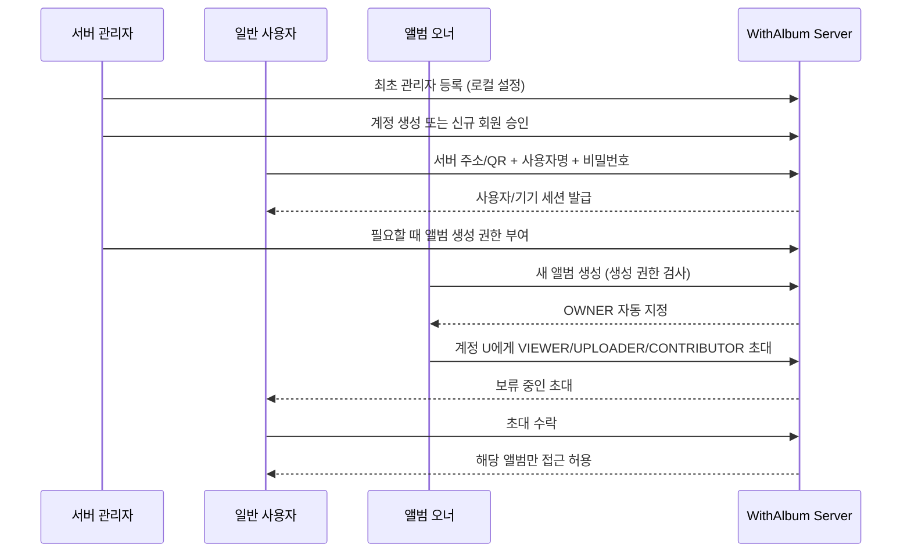

# 위드앨범(WithAlbum) 계정·오너·초대·권한 설계 v1.4

- 기준: 2026-10-17
- 상태: **P0 확정 설계 / 정책 함수·계정 코어·HTTP 로그인·기기 세션·계정 관리 API·앨범 ACL(폴더·업로드·동기화·다운로드)·초대·역할 변경·추방·소유권 이전·보관 구현**(테스트·로컬 바이너리 스모크 검증).
- 적용 대상: `SELF_HOSTED` Mac mini 우선 (동일 Go 서버 코어를 Linux/Raspberry Pi에도 적용).
- Google Drive 지원: 아래 **[Drive 별도 제한]**을 반드시 확인. 네이티브 ACL과 동일하지 않다.

## 0. 핵심 불변식

1. **서버 계정 != 공유 앨범 접근권한**. 로그인만으로 폴더 목록, 미리보기, 파일 원본에 접근할 수 없다.
2. **서버 가입 != 앨범 생성권한**. 일반 사용자의 `can_create_albums` 기본값은 `false`.
3. **한 앨범에는 정확히 한 명의 오너**. `folders.owner_user_id`가 유일한 원본(source of truth)이며, 멤버십 테이블에는 OWNER 역할을 중복 저장하지 않는다.
4. **오너만 초대·역할 변경·멤버 추방·앨범 삭제·소유권 이전**. 서버 관리자는 특별한 관리자 승인/복구 기능으로 별도 조치할 수 있지만, 평시 API에서 자동 오너가 되지 않는다.
5. **모든 API 요청마다 서버에서 접근 검사**, 기본 거부. UI에서 버튼만 숨기는 것은 접근 제어가 아니다.
6. **업로드 전용은 실제로 읽을 수 없다**. 목록, 커서, 썸네일, 원본, 공용 자산 메타데이터, 전역 중복 여부 공개 금지.
7. **로그인·권한 회수는 기기별로 추적**. 권한이 바뀐 즉시 서버는 새 요청에서 거절한다. 이미 다운로드된 사본의 강제 회수는 불가능하다.

## 1. 2중 권한 모델

### 서버 범위

| 서버 권한 | 관리 계정/기기 | 앨범 생성 | 남의 비공개 앨범 열람 |
|---|---|---|---|
| `SERVER_ADMIN` | 가능 | 가능 | **기본 거부**. 앨범 소유권 없이는 앱 API 열람 불가 |
| `USER` + `can_create_albums=true` | 불가 | 가능 | 초대된 앨범만 |
| `USER` 기본값 | 불가 | 불가 | 초대된 앨범만 |

최초 서버 설치 시 로컬 초기 설정 마법사에서 관리자 1명을 만든다. 관리자 등록 없이 누구든 첫 원격 접속에서 관리자가 되게 하지 않는다. 일반 사용자는 관리자가 신규 계정을 만들거나 승인한다. 이메일/공개 인터넷 가입은 선택적 후속 기능으로 다룬다.

### 앨범 범위

| 작업 | OWNER | CONTRIBUTOR (읽기+업로드) | VIEWER (읽기) | UPLOADER (업로드만) |
|---|:---:|:---:|:---:|:---:|
| 최소 앨범 이름/내 역할 조회 | O | O | O | O |
| 사진 목록 및 증분 변경 내역 조회 | O | O | O | X |
| 미리보기·원본 다운로드 | O | O | O | X |
| 사진 업로드 | O | O | X | O |
| 타인의 사진 삭제 / 폴더 설정 | O | X | X | X |
| 초대·추방·역할 변경 | O | X | X | X |
| 소유권 이전 / 앨범 삭제 | O | X | X | X |

초기 CONTRIBUTOR에게는 **타인의 파일 삭제 권한을 주지 않는다**. 본인이 업로드한 항목을 철회하는 기능은 추후 별도 정책·감사 로그와 함께 검토한다.

읽기 권한자(OWNER·CONTRIBUTOR·VIEWER)는 자산마다 촬영 시각(`captured_at`, 서버가 원본에서 읽은 값만)과 올린 사람의 **표시 이름**(`uploaded_by_name`; 로그인 아이디·user_id·이메일 아님, 비활성·로그인 불가·없는 계정은 null)을, 폴더 요약에서 멤버 수(`member_count`: 오너 + 로그인 가능한 활성 멤버, 대기 초대 제외)를 본다. 멤버 목록과 대기 초대는 계속 오너 전용이다.

UPLOADER는 업로드 대상 선택을 위해 최소한의 앨범 이름 및 자신의 역할은 볼 수 있다(멤버 수·촬영 시각·올린 사람은 보지 않는다 — 폴더 응답에 `member_count` 키 자체가 없다). 하지만 업로드한 원본을 서버에서 다시 읽거나 타인 자료의 존재를 유추할 API는 제공하지 않는다. 클라이언트는 자기 **로컬 대기열과 전송 영수증**만 표시할 수 있다. UI에서 보이는 로컬 사본은 서버 다운로드 권한을 뜻하지 않는다.

## 2. 로그인·등록·초대 시나리오



- `POST /api/v1/auth/login`: 사용자명/비밀번호 로그인. 단순한 서버 주소를 아는 것만으로는 계정이 생기지 않는다.
- `POST /api/v1/admin/users`: **SERVER_ADMIN**만 계정 생성/승인/비활성화. 운영 정책에 따라 임시 암호 또는 일회성 설정 링크를 제공.
- `POST /api/v1/folders`: 관리자 또는 `can_create_albums` 부여된 일반 사용자만. 생성한 사람이 `owner_user_id`.
- `POST /api/v1/folders/{id}/invitations`: OWNER가 **서버에 등록된 계정 ID**를 지정하고 ROLE을 선택. 이름 없는 공개 초대 링크는 기본 비활성.
- `POST /api/v1/invitations/{id}/accept`: 대상 계정이 본인 세션으로 수락해야 멤버십 생성. 수락 전 접근 불가.
- `POST /api/v1/invitations/{id}/decline`: 대상 계정이 본인 세션으로 거절. 멤버십은 생기지 않고 초대는 더 이상 대기 상태가 아니다.
- 서버에 아직 없는 친구를 초대하려면 오너가 관리자에게 계정 발급 요청하거나 초대 대상자가 관리자 승인 가입을 한다. **앨범 초대만으로 서버 회원가입 권한을 우회하지 않는다**.
- 초대는 만료·일회성·대상 계정 고정, 수락·취소 기록이 남아야 한다.

## 3. 소유권 이전, 계정 정지, 삭제

- 소유권은 한 명. 오너 이전 시 새 오너는 같은 서버의 활성 계정이어야 한다. 이전은 **DB 트랜잭션 1개**로 처리하고 감사 로그 기록. 기존 오너의 이후 역할은 별도 확인 (기본 CONTRIBUTOR로 전환을 제안).
- 오너가 계정 탈퇴·비활성화하려면 먼저 앨범 이전 또는 관리자에 의한 안전한 재배정을 요구. **오너 없는 앨범 허용하지 않음**.
  - 구현(M17): 사용 중 앨범은 오너만 이전(`POST /folders/{id}/owner`). **보관된 앨범**은 SERVER_ADMIN이 다른 활성 계정에 재배정(`POST /api/v1/admin/folders/{id}/owner`, 1 트랜잭션·호출자 재판정·감사 `folder.reassign_archived_owner`). 보관 상태가 유지되어 새 오너·관리자 모두 열람 불가(404), 이전 오너는 멤버가 되지 않음. 사용 중 앨범에 대한 요청은 없는 앨범과 같은 404. 관리자가 볼 수 있는 것은 계정별 사용 중 앨범 개수와 보관 앨범 ID·날짜뿐(`GET /api/v1/admin/users/{id}/folders`).
- 관리자 자신이 가진 폴더도 같은 규칙을 따름. 최소 1명의 활성 SERVER_ADMIN을 유지.
- 초대/멤버십 제거 직후 인증된 후속 조회는 거부. 앱의 로컬 캐시 삭제를 요청하지만 이미 저장·내보낸 파일은 기술적으로 강제 회수 불가.
- 서비스 운영자는 물리적 저장장치와 파일시스템 접근권을 가질 수 있다. **앱 레벨 관리자에게 열람권을 주지 않는 것**과 **물리적으로 암호학적 프라이버시를 보장하는 것**은 다르다. E2EE는 별도 기능.

## 4. API 강제 검사 규칙

```text
Request → HTTPS 및 세션 검증 → user 활성 확인 → folder_id/asset_id 조회
→ 서버 권한 + owner/membership 조회 → 액션별 허용(deny by default)
→ 데이터 제공 또는 변경 → 감사 로그
```

- 폴더를 전부 가져오는 API는 **사용자가 오너/멤버인 항목만 반환**한다. 초대된 앨범이라도 역할에 따른 최소 메타데이터만 공개.
- 미리보기 및 원본 다운로드는 **asset_id 자체**가 아니라, 해당 자산이 **읽기 허용된 앨범에 연결되었는지**를 반드시 검증. 같은 원본 바이트가 CAS에 이미 있어도 접근권이 생기지 않는다.
- 단일 자산이 여러 앨범에 속할 수 있으므로 GET 다운로드에서는 권한이 있는 앨범을 조회하거나 `folder_id`를 함께 받아 연관성을 검증한다. 숨겨진 앨범 ID는 404로 가려 열거를 방지한다.
- UPLOADER에게 `/assets/check`로 **전역 또는 타인 앨범 해시 존재 여부**를 알려주지 않는다. 응답은 새 업로드/중복 여부와 무관하게 일반화하거나 이 역할에서는 사전 중복 조회를 막는다. 실제 서버는 내부에서 SHA-256 확인 후 CAS 중복 제거.
- 자산 공개 ID는 추측 가능한 SHA-256 대신 **랜덤 논리 ID**를 권장. 블롭 해시는 내부 중복 제거용.
- 대기열/재시도 API는 멤버십 확인을 건너뛰지 않는다. 업로드 중 권한이 취소됐다면 커밋 전 다시 확인한다.
- 감사 항목: 로그인 성공/실패(민감정보 제외), 계정 승인, 생성 권한 부여, 앨범 생성, 멤버 초대·추방, 역할 변경, 오너 이전, 다운로드 승인/거부(운영 규모에 따라 집계), 저장소 오류.

## 5. 보안·계정 저장

- 비밀번호: **Argon2id + 계정별 임의 salt**, 파라미터 버전 저장. **사진 무결성용 SHA-256을 비밀번호 해시로 사용하지 않는다**.
- 모바일: 단기 access token + 기기별 회전 가능한 refresh token, 서버는 refresh token의 해시만 저장. iOS Keychain/Android Keystore-backed storage에 보관.
- 웹 대시보드: Secure/HttpOnly/SameSite 쿠키와 CSRF 보호. 로컬 API에서 부실한 CORS/브라우저 토큰 저장을 피한다.
- LAN에서도 비밀번호 또는 세션이 전송된다면 **검증된 TLS**가 필요하다. 구현(M15): 서버 자체 서명 인증서 + 앱의 SPKI SHA-256 핀닝(페어링 페이로드는 콘솔 `withalbum-server tls`·관리자 대시보드). LAN listen은 `-allow-lan` + `-tls` + 로그인 가능한 SERVER_ADMIN이 모두 있을 때만, 평문 HTTP는 loopback만. 인터넷 원격 접속 방식은 미정.
- 관리자 로그인 속도 제한, 계정 잠금 남용 완화, 기기 토큰 개별 해지, 이벤트 감사 로그, 비밀번호 변경 시 활성 세션 재검증.
- 관리자 초기화 경로는 **서버 물리 콘솔에 접근할 수 있는 운영자**에게만 허용. 외부 요청으로 초기 관리자 선점 불가.

## 6. Google Drive 모드: 동일한 권한을 약속하면 안 됨

Drive의 개인 My Drive ACL 역할은 `owner`, `writer`, `commenter`, `reader` 등이 있고, `writer`는 **읽기뿐 아니라 파일 수정·삭제까지 가능**하다. 따라서 **위드앨범의 `UPLOADER(쓰기 전용)`를 Google Drive의 `writer`로 매핑하는 것은 잘못**이다.

| 위드앨범 권한 | Self-hosted | Google Drive (서버 없는 기본 모드) |
|---|---|---|
| OWNER | 완전 지원 | Drive 소유권과 정책에 종속, 별도 검증 |
| VIEWER | 완전 지원 | `reader` 등으로 제공 가능 |
| CONTRIBUTOR | 읽기·업로드, 관리자 기능 제외 | `writer`에 근사하지만 원본 수정/삭제 범위 더 넓음 |
| UPLOADER (읽기 불가) | **완전 지원 목표** | **미지원**. Google Drive API 권한만으로 동등하게 강제 불가 |
| 서버 관리자/앨범 생성 허가 | 완전 지원 목표 | 독립형 Drive 모드에는 중앙 서버 관리자가 없음 |

앱에서만 사진 목록을 숨긴다고 Drive 웹이나 다른 OAuth 앱을 통한 접근을 차단할 수 없다. Drive용 읽기 제한 또는 제출함을 구현하려면 별도 업로드 게이트웨이/서비스와 권한 격리가 필요하므로 **서버 설치 없이 되는 Drive 초기 모드 범위 밖**으로 둔다.

앱 권한을 표시할 때는 provider 기능 목록으로 가능한 기능만 노출하고, **저장소 자체의 실효 ACL**을 기준으로 제한 안내를 제공한다.

## 7. 검증할 수용 테스트

1. 서버 관리자만 일반 사용자를 생성·중단하고 계정별 앨범 생성 허가를 조정할 수 있다.
2. USER는 기본적으로 새 앨범을 못 만든다. 권한을 받은 USER는 새 앨범 생성과 동시에 OWNER가 된다.
3. 이름만 알면 앨범을 가져올 수 있는 IDOR 문제를 차단한다.
4. VIEWER 업로드는 403. UPLOADER 목록/변경 커서/프리뷰/원본 요청은 403 또는 404.
5. CONTRIBUTOR는 목록·다운로드·업로드 가능. 다른 사람 사진 삭제/멤버 초대는 거부.
6. OWNER만 유효한 서버 계정을 역할과 함께 초대. 수락 전 접근 거부.
7. 탈퇴·차단·역할 하향 즉시 기존 세션에서 재검사. 이전에 다운로드한 원본의 원격 삭제를 약속하지 않는다.
8. UPLOADER 파일을 중복 업로드해도 타인의 자산 식별·존재 여부를 유추할 수 없다.
9. 파일 원본과 프리뷰에서 서로 다른 앨범의 권한이 섞이지 않는다.
10. 오너 이전 실패 시 롤백되고 앨범에 오너가 항상 한 명이다.
11. SERVER_ADMIN도 멤버가 아닌 앨범의 파일을 앱 API로 열람하지 않는다.
12. Raspberry Pi와 Mac mini에서 동일한 서버 권한 정책이 적용된다.

## 8. 구현 상태와 일정

- **정책 규칙 구현:** `internal/authz/policy.go` + `policy_test.go` (순수 판정 함수 및 단위 테스트)
- **계정 코어 구현(콘솔 전용, HTTP 미연결):**
  - `internal/auth/password`: Argon2id, PHC 문자열 `$argon2id$v=19$m=65536,t=3,p=2$<salt>$<key>`(16바이트 랜덤 salt, 32바이트 키). 파라미터가 해시마다 기록되어 기본값을 바꿔도 기존 해시가 검증되며, `NeedsRehash`로 재해시 필요 여부를 판정한다. 검증은 상수시간 비교, 정규형이 아니거나 파라미터 상한(메모리 1GiB, t≤16, p≤16)을 넘는 값은 거부, `!`로 시작하는 잠금 값은 어떤 입력으로도 검증되지 않는다. 정책: 최소 12자(문자 수), 최대 1024바이트, 유효한 UTF-8, NUL·줄바꿈 금지. 측정(Apple M1 Pro, 기본 파라미터): 해시·검증 각 약 67ms, 1회 64MiB 할당 → 로그인 API에서 동시 해시 계산 수를 제한해야 한다.
  - `internal/users`: 사용자 생성·조회·비활성/재활성·역할·앨범 생성 권한·비밀번호 재설정. 마지막 "사용 가능한 활성 SERVER_ADMIN"(잠금 비밀번호 제외)은 비활성·강등 거부. 앨범 소유자는 비활성 거부(트리거 `cannot_disable_owner`). 모든 변경은 같은 트랜잭션에서 `audit_log`에 기록(`internal/audit`, 비밀번호·해시·토큰 키는 기록 거부).
  - 최초 관리자(**서버 콘솔 전용**): `withalbum-server admin init -login <이름>`. 기존 폴더를 소유한 잠금 bootstrap 계정(`account_bootstrap`, 처음 이름 `admin`)을 **인수**한다. user_id를 유지하므로 레거시 폴더 소유가 그대로이며, 한 번만 가능하다. 인수 전에는 bootstrap 계정을 다른 방법으로 바꿀 수 없고 다른 계정도 만들 수 없다. 이름 `admin`은 인수 전에는 bootstrap 계정이 점유하고, 인수 때 그대로 둘 수도 있으며, 다른 이름으로 바꾸면 일반 계정에 쓸 수 있다(bootstrap 식별은 이름이 아니라 user_id).
  - 일반 사용자: 관리자가 콘솔 `admin create-user`로 생성(기본 USER, `can_create_albums=false`). 가입 신청은 후속.
  - 복구: `admin reset-password` (콘솔 전용, `SECURITY.md` 참조).
- **로그인·세션 구현(HTTP, 테스트·로컬 바이너리 스모크 검증):** 규격은 `docs/API_v2.yaml`(통합, M16).
  - `internal/auth/session`: 로그인 1회 = `devices` 1행 + `auth_sessions` 1행(마이그레이션 0005로 access 토큰 해시·만료, CSRF 해시, 교환된 refresh 기록 `auth_refresh_used` 추가). 토큰은 256비트 랜덤(base64url), DB에는 SHA-256만 저장. access 15분, refresh 30일(교환 때마다 창 재시작). refresh는 access·refresh를 모두 회전해 이전 토큰은 즉시 무효. 이미 교환된 refresh가 다시 오면 **세션 전체 폐기**(재사용 감지, `auth.refresh_reuse` 감사). 같은 refresh로 동시에 두 번 요청해도 재사용으로 간주된다(앱은 refresh를 직렬화해야 함).
  - `internal/httpapi/middleware_auth.go` `RequireSession`: Bearer 또는 웹 쿠키. **매 요청 DB에서 세션·기기·계정 상태를 재조회**해 `authz.Principal`을 만든다(`PrincipalFrom`). 비활성·기기 해지·만료는 다음 요청에서 401, 역할·앨범 생성 권한 변경도 다음 요청에 반영.
  - 웹(platform `web`): 토큰을 본문에 주지 않고 HttpOnly·SameSite=Strict 쿠키(`withalbum_access` Path=/api/, `withalbum_refresh` Path=/api/v1/auth/) + 읽을 수 있는 `withalbum_csrf` 쿠키. 쿠키로 인증된 GET/HEAD/OPTIONS 이외 요청은 `X-CSRF-Token` 필수(없거나 틀리면 403). Authorization 헤더가 있으면 쿠키는 무시. 본문은 `application/json`만 허용(교차 사이트 폼 차단). Secure는 TLS 요청에서 설정(현재는 loopback HTTP 전용, TLS는 M15).
  - 사용자 열거 방지: 없는 계정·잠금 계정·비활성 계정·틀린 비밀번호 모두 같은 401 본문, 없는/잠금 계정도 더미 해시로 Argon2id 1회 수행(스모크 측정: 없는 계정 111ms, 틀린 비밀번호 107ms, 기본 파라미터).
  - Argon2id 동시 계산 수 제한(`password.Limiter`, 기본 2개 = 최대 128MiB, 슬롯 대기 5초 초과 시 503 busy).
  - 속도 제한(`internal/auth/ratelimit`, 메모리, 프로세스 재시작 시 초기화): IP당 10회 버스트 후 6초에 1회, 계정+IP 실패 5회 / 계정 전체 실패 20회 per 15분 → 429 + Retry-After. 존재하지 않는 계정 이름에도 똑같이 적용. 키 수 상한(가득 차면 새 키 거부, fail closed). 프록시 헤더는 신뢰하지 않는다.
  - 감사: 로그인 성공/실패(사유·IP, 비밀번호 제외), 제한 시작(차단 1회당 1행), 로그아웃, 기기 해지, refresh 재사용, 비밀번호 변경·재설정(폐기된 세션 수), 계정 생성·비활성·권한 변경(HTTP 관리자 행위자 포함).
  - 세션 회수: 콘솔·관리자 비밀번호 재설정은 모든 세션, 본인 비밀번호 변경(`POST /me/password`)은 현재 세션 외 전부, 계정 비활성화는 모든 세션을 같은 트랜잭션에서 폐기(`session.RevokeUserTx`). 재활성화해도 이전 세션은 살아나지 않는다.
  - 관리자 API: `GET/POST /admin/users`, `GET/PATCH /admin/users/{id}`(status), `PATCH /admin/users/{id}/permissions`(server_role·can_create_albums 한 트랜잭션). SERVER_ADMIN 아니면 403. 최초 관리자는 여전히 콘솔 `admin init`만.
- **앨범 ACL 구현(HTTP, 테스트·로컬 바이너리 스모크 검증):**
  - 라우트 정책 표(`internal/httpapi/middleware_authz.go` `routePolicies`): 모든 라우트가 public / session / server(액션) / album(액션) 중 하나로 선언된다. 선언 없는 라우트를 등록하거나 선언된 라우트를 등록하지 않으면 핸들러 구성 시 panic. 공개는 대시보드 페이지(정적), `GET /api/v1/health`, `POST /api/v1/auth/login|refresh` 4개뿐이고, 그 밖의 `/api/v1/*`(알 수 없는 경로 포함)는 세션 없이 401.
  - album 라우트: 세션 → 요청마다 DB에서 `folders.owner_user_id`와 `folder_members`(`GetFolderAccess`) → `authz.Allowed`. 판정 순서와 응답(D12): 폴더 없음·보관됨·소유/멤버 아님 → **404 `folder_not_found`**(SERVER_ADMIN도 동일, 존재 여부 비노출) → 멤버지만 역할이 액션을 허용하지 않음 → **403 `forbidden`** → 자산 조회. UPLOADER의 읽기 시도는 자산 ID가 있든 없든 같은 403이라 존재를 추론할 수 없다.
  - 폴더 목록은 소유·멤버 폴더만(`ListFoldersFor`), 각 항목은 이름·`role`·`can_read`·`can_upload`만. 폴더 생성은 SERVER_ADMIN 또는 `can_create_albums`, 쓰기 트랜잭션 안에서 다시 확인하고 생성자를 유일 OWNER로 기록.
  - 자산: 공개 ID는 랜덤 `assets.asset_id`이고 **폴더마다 새 자산**을 만든다(같은 바이트는 blob만 공유). 그래서 한 폴더의 파일명·업로더·ID가 다른 폴더에 나타나지 않고, 다른 폴더의 자산 ID는 `GetFolderAsset`(folder_assets 연결, `removed_at IS NULL`)에서 404. 이관 데이터의 자산은 여러 폴더에 연결될 수 있지만 다운로드는 항상 경로의 폴더 연결로 검증한다.
  - 업로드: 요청 진입 시 판정 + **커밋 직전 재확인**(`meta.CommitRequest.Authorize`, `BEGIN IMMEDIATE` 쓰기 트랜잭션 안에서 계정 상태·잠금 여부·세션/기기 해지·소유자·멤버십을 다시 읽음; 계정·멤버십 변경도 같은 DB 쓰기이므로 그 사이 바뀔 수 없다). 회수되면 403/404, 자산·연결·이벤트 기록 없음. 결과가 `already_present`여도 재확인한다.
  - UPLOADER 응답: 신규·다른 폴더에 이미 있는 바이트·이 폴더에 이미 있는 바이트 모두 같은 `202 {"result":"accepted","folder_id","sha256","bytes"}`(클라이언트가 보낸 것만 되돌림). 읽기 권한자에게도 "다른 폴더에 있음"(`linked`)은 `created`로 합쳐 전역 존재를 알리지 않는다. 이미 있는 바이트도 pool 파일 재해시·프리뷰 재생성을 똑같이 수행한다. **남은 한계:** 지연 시간 차이(로컬 측정 수 ms, 새 디렉터리 항목·DB 행 fsync 유무)는 완전히 없애지 못했다.
  - 권한 회수 즉시 반영: 역할 하향·멤버 제거·앨범 생성 권한 회수는 다음 요청에서 403/404, 계정 비활성·기기 해지는 401.
- **초대·멤버·소유권 이전·보관 구현(HTTP, 테스트·로컬 바이너리 스모크 검증):** `internal/meta/sqlitestore/memberships.go`(`meta.Memberships`), `internal/httpapi/members.go`.
  - 관리 라우트는 모두 OWNER만(`authz` 액션 `InviteMember`·`ListMembers`·`ChangeMemberRole`·`RevokeMember`·`TransferOwner`·`DeleteAlbum`). 멤버는 403, 비멤버·관리자는 404. 쓰기는 요청 진입 판정 + **같은 쓰기 트랜잭션 안에서 계정·세션·소유자·멤버십을 다시 읽어 재판정**하고, 변경과 `audit_log` 행을 함께 커밋한다(토큰·비밀 값은 기록하지 않음).
  - 초대(`POST /folders/{id}/invitations`): 대상은 `user_id`로 지정한 **활성·로그인 가능한 등록 계정**. 없는 계정·비활성·잠금 계정은 똑같은 404 `invitee_not_found`(상태 비노출). 오너·기존 멤버는 409 `already_member`, 같은 앨범·대상의 대기 초대는 1개(409 `invitation_pending`, 부분 UNIQUE 인덱스, 마이그레이션 0006). 만료 7일(`meta.InvitationTTL`), 만료는 **조회·수락 시 판정**하고 만료된 대기 행은 같은 대상을 다시 초대할 때 `expired`로 바꾼다. 초대는 계정이 고정되고 수락에 그 계정의 세션이 필요하므로 **베어러 토큰이 없다**(`token_sha256`는 NULL, 공개 초대 링크는 지원하지 않음). 초대 ID는 128비트 랜덤.
  - 수락(`POST /invitations/{id}/accept`): 1 트랜잭션(멤버십 생성 + `accepted` + 감사). 없는 ID 404, 다른 계정(관리자 포함) 403, 이미 수락·취소·만료·앨범 보관·작성자가 더 이상 오너가 아님 410 `invitation_gone`. 동시 수락은 1건만 성공. 수락 전에는 앨범이 404.
  - 거절(`POST /invitations/{id}/decline`, 마이그레이션 0009가 `folder_invitations.status`에 `declined` 추가): 수락과 같은 판정 — 없는 ID 404, 다른 계정(관리자·오너 포함) 403, 이미 수락·취소·만료·거절·앨범 보관·작성자가 더 이상 오너가 아님 410 `invitation_gone`(이 경우 아무것도 쓰지 않음, 만료된 행도 그대로). 1 트랜잭션(`declined` + 감사 `invitation.decline`: 앨범·역할·보낸 사람, 토큰·비밀 없음), 응답 204(앨범 정보 없음). 수락과 거절이 겹치면 하나만 성공. 거절된 초대는 대기 상태가 아니므로 본인 목록과 오너의 대기 목록에서 빠지고(오너에게 "거절함"을 따로 알리지 않음 — 대기 초대가 사라질 뿐), 대기 초대 부분 UNIQUE 인덱스에 걸리지 않아 오너가 같은 계정을 다시 초대할 수 있다. 거절된 초대의 취소는 410.
  - 대기 초대 목록: 본인 것만(`GET /invitations`), 오너는 앨범의 대기 초대(`GET /folders/{id}/invitations`, 수락·취소·만료·거절된 초대는 빠짐)·취소(`DELETE .../invitations/{iid}`, 이미 끝난 초대 410).
  - 역할 변경(`PATCH /folders/{id}/members/{uid}`)·추방(`DELETE`): 대상이 오너면 409 `target_is_owner`, 멤버가 아니면 404 `member_not_found`. 다음 요청부터 새 역할로 판정(하향 → 403, 추방 → 404, 업로드 중 추방 → 커밋 재확인에서 404).
  - 소유권 이전(`POST /folders/{id}/owner`, `new_owner_user_id`): 새 오너는 **현재 멤버이며 활성 계정**이어야 한다(아니면 404 `member_not_found` / 409 `user_inactive`). 앨범을 동의 없는 계정에 떠넘기지 않기 위해 멤버로 제한했다. 1 트랜잭션: 새 오너 멤버십 삭제 → `owner_user_id` 변경 → 이전 오너를 **CONTRIBUTOR** 멤버로 삽입(트리거 순서) → 대기 초대 전부 취소 → 감사. 중간 실패는 전부 롤백되고 오너는 항상 1명(실패 주입 테스트).
  - 보관(`DELETE /folders/{id}`): `archived_at` 설정 + 대기 초대 취소 + 감사. 파일·행은 남고 모든 라우트에서 404(오너 포함). 복원 API는 없다. **한계:** 보관된 앨범도 소유로 남아 그 오너 계정은 비활성화할 수 없다(트리거 `cannot_disable_owner`); 관리자 복구 기능은 후속.
- **M16 추가(HTTP 테스트·로컬 바이너리 스모크 검증):**
  - 사진 제거 `DELETE /folders/{fid}/assets/{aid}`: OWNER만(§7-5: CONTRIBUTOR는 자기 사진도 403, VIEWER·UPLOADER 403, 비멤버·관리자 404). 트랜잭션 안 재판정 + `asset.remove` 감사, `asset_removed` tombstone. 원본 파일은 지우지 않는다(GC 없음).
  - `/assets/check`: 읽기 권한자만, **이 폴더의** 해시만 대조(전역·타 폴더 존재 비노출). UPLOADER 403(§4 "이 역할에서는 사전 중복 조회를 막는다").
  - 멱등 키는 계정·세션 기기·폴더 범위(`upload_receipts` PK). 다른 계정·기기·폴더의 같은 키 문자열은 별개 요청이라 결과·존재가 교차 노출되지 않는다. 모든 업로드가 영수증을 같은 트랜잭션에 기록하므로 UPLOADER의 신규/중복 업로드가 같은 쓰기·fsync 경로를 탄다(지연 차이 완화; 새 pool 파일의 디렉터리 fsync 차이는 남음).
  - refresh 유예: 앱(Bearer) refresh 토큰이 교환 후 30초 안에, 그 뒤 다른 교환 없이 다시 오면 1회만 재회전(`auth.refresh_grace` 감사), 첫 교환이 발급한 토큰은 사용된 것으로 기록. 유예 밖·두 번째·브라우저는 기존대로 세션 폐기. 대가: 토큰을 훔친 쪽이 정상 기기 직후 30초 안에 쓰면 정상 기기의 다음 refresh까지 세션을 얻는다(그때 재사용 감지로 폐기).
  - 세션 절대 만료 90일, 로그인 성공 시 파라미터가 다르면 재해시(`account.password_rehash`), 6시간마다 30일 지난 폐기·만료 세션 행·만료된 used refresh·30일 지난 업로드 영수증 정리(기기 행은 유지).
  - 관리자: `GET /admin/users/{uid}/devices`, `DELETE /admin/users/{uid}/devices/{did}`(`device.admin_revoke`, 행위자 = 관리자). 앨범 열람권은 여전히 없음.
  - 감사: 본인 비밀번호 변경 실패(`account.password_change` denied), 권한 거부 요약(`access.denied`: 계정·라우트·상태별 첫 거부를 즉시, 이후 10분 창 동안은 개수만 세어 다음 행의 `suppressed_before`로). 401은 기록하지 않는다(행위자 없음, DB 쓰기 폭주 방지).
- **좋아요·댓글·멘션 (M49, 서버 모드만):** 동작 `react_to_asset`(좋아요, 댓글 작성·본인 댓글 수정·삭제) = OWNER·CONTRIBUTOR·VIEWER, `moderate_comments`(남의 댓글 삭제) = OWNER. 읽기(누른 사람·댓글·멘션 대상 목록)는 `list_album_assets`와 같음. UPLOADER는 모두 403·이벤트 없음, 비멤버·관리자 404. 이름(누른 사람·작성자·멘션)은 읽는 순간 그 앨범 읽기 권한자인 활성 계정만 표시. 추방·UPLOADER로 변경 시 그 앨범의 좋아요 삭제, 댓글은 작성자 없이 유지, 사진 제거 시 좋아요·댓글 삭제. Drive 모드는 같은 보장을 할 수 없어 숨김(§6).
- **미구현:** 멤버 스스로 탈퇴, 보관 앨범 복원·관리자 복구(설계 메모: 마일스톤 M16 파일), 앱 UX(핀닝 구현 포함), Drive 계정 연동, 이벤트 보존 기간·삭제(409 경로만 구현).
- 구현 순서: SQLite 트랜잭션 및 마이그레이션 → 최초 관리자 생성/로그인 → 권한 미들웨어 → 폴더 오너/멤버 권한 → 초대/수락/회수 → 전체 통합 테스트 → Mac LAN 테스트.
- **중요:** LAN 공개는 위 TLS 게이트에서만 가능하다(SECURITY.md). 인터넷 공개·대체 불가능한 원본의 유일 저장소로 사용하면 안 된다.

## 공식 기술 근거

- OWASP Authorization: https://cheatsheetseries.owasp.org/cheatsheets/Authorization_Cheat_Sheet.html
- OWASP Password Storage: https://cheatsheetseries.owasp.org/cheatsheets/Password_Storage_Cheat_Sheet.html
- OWASP Session Management: https://cheatsheetseries.owasp.org/cheatsheets/Session_Management_Cheat_Sheet.html
- Google Drive roles: https://developers.google.com/workspace/drive/api/guides/ref-roles
- Google Drive sharing & inherited access: https://developers.google.com/workspace/drive/api/guides/manage-sharing
