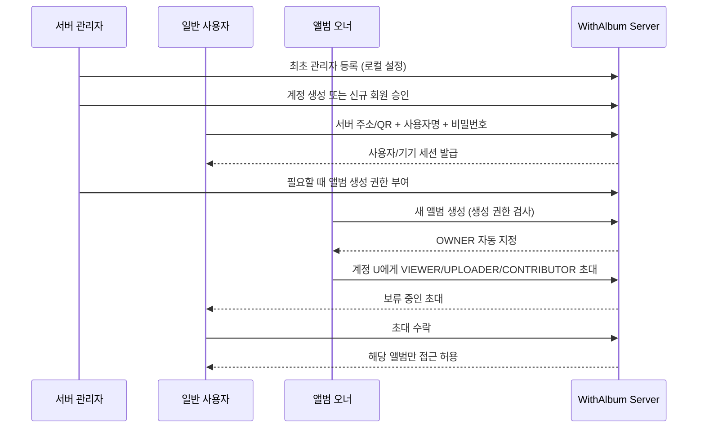

# 위드앨범(WithAlbum) 계정·오너·초대·권한 설계 v1.4

- 기준: 2026-10-17
- 상태: **P0 확정 설계 / 정책 함수·계정 코어(콘솔 전용) 구현**. HTTP 서버에 로그인·실제 ACL 적용 전.
- 적용 대상: `SELF_HOSTED` Mac mini 우선 (동일 Go 서버 코어를 Linux/Raspberry Pi에도 적용).
- Google Drive 지원: 아래 **[Drive 별도 제한]**을 반드시 확인. 네이티브 ACL과 동일하지 않다.

## 0. 핵심 불변식

1. **서버 계정 != 공유 앨범 접근권한**. 로그인만으로 폴더 목록, 미리보기, 파일 원본에 접근할 수 없다.
2. **서버 가입 != 앨범 생성권한**. 일반 사용자의 `can_create_albums` 기본값은 `false`.
3. **한 앨범에는 정확히 한 명의 오너**. `folders.owner_user_id`가 유일한 원본(source of truth)이며, 멤버십 테이블에는 OWNER 역할을 중복 저장하지 않는다.
4. **오너만 초대·역할 변경·멤버 추방·앨범 삭제·소유권 이전**. 서버 관리자는 특별한 관리자 승인/복구 기능으로 별도 조치할 수 있지만, 평시 API에서 자동 오너가 되지 않는다.
5. **모든 API 요청마다 서버에서 접근 검사**, 기본 거부. UI에서 버튼만 숨기는 것은 접근 제어가 아니다.
6. **업로드 전용은 실제로 읽을 수 없다**. 목록, 커서, 썸네일, 원본, 공용 자산 메타데이터, 전역 중복 여부 공개 금지.
7. **로그인·권한 회수는 기기별로 추적**. 권한이 바뀐 즉시 서버는 새 요청에서 거절한다. 이미 다운로드된 사본의 강제 회수는 불가능하다.

## 1. 2중 권한 모델

### 서버 범위

| 서버 권한 | 관리 계정/기기 | 앨범 생성 | 남의 비공개 앨범 열람 |
|---|---|---|---|
| `SERVER_ADMIN` | 가능 | 가능 | **기본 거부**. 앨범 소유권 없이는 앱 API 열람 불가 |
| `USER` + `can_create_albums=true` | 불가 | 가능 | 초대된 앨범만 |
| `USER` 기본값 | 불가 | 불가 | 초대된 앨범만 |

최초 서버 설치 시 로컬 초기 설정 마법사에서 관리자 1명을 만든다. 관리자 등록 없이 누구든 첫 원격 접속에서 관리자가 되게 하지 않는다. 일반 사용자는 관리자가 신규 계정을 만들거나 승인한다. 이메일/공개 인터넷 가입은 선택적 후속 기능으로 다룬다.

### 앨범 범위

| 작업 | OWNER | CONTRIBUTOR (읽기+업로드) | VIEWER (읽기) | UPLOADER (업로드만) |
|---|:---:|:---:|:---:|:---:|
| 최소 앨범 이름/내 역할 조회 | O | O | O | O |
| 사진 목록 및 증분 변경 내역 조회 | O | O | O | X |
| 미리보기·원본 다운로드 | O | O | O | X |
| 사진 업로드 | O | O | X | O |
| 타인의 사진 삭제 / 폴더 설정 | O | X | X | X |
| 초대·추방·역할 변경 | O | X | X | X |
| 소유권 이전 / 앨범 삭제 | O | X | X | X |

초기 CONTRIBUTOR에게는 **타인의 파일 삭제 권한을 주지 않는다**. 본인이 업로드한 항목을 철회하는 기능은 추후 별도 정책·감사 로그와 함께 검토한다.

UPLOADER는 업로드 대상 선택을 위해 최소한의 앨범 이름 및 자신의 역할은 볼 수 있다. 하지만 업로드한 원본을 서버에서 다시 읽거나 타인 자료의 존재를 유추할 API는 제공하지 않는다. 클라이언트는 자기 **로컬 대기열과 전송 영수증**만 표시할 수 있다. UI에서 보이는 로컬 사본은 서버 다운로드 권한을 뜻하지 않는다.

## 2. 로그인·등록·초대 시나리오



- `POST /api/v1/auth/login`: 사용자명/비밀번호 로그인. 단순한 서버 주소를 아는 것만으로는 계정이 생기지 않는다.
- `POST /api/v1/admin/users`: **SERVER_ADMIN**만 계정 생성/승인/비활성화. 운영 정책에 따라 임시 암호 또는 일회성 설정 링크를 제공.
- `POST /api/v1/folders`: 관리자 또는 `can_create_albums` 부여된 일반 사용자만. 생성한 사람이 `owner_user_id`.
- `POST /api/v1/folders/{id}/invitations`: OWNER가 **서버에 등록된 계정 ID**를 지정하고 ROLE을 선택. 이름 없는 공개 초대 링크는 기본 비활성.
- `POST /api/v1/invitations/{id}/accept`: 대상 계정이 본인 세션으로 수락해야 멤버십 생성. 수락 전 접근 불가.
- 서버에 아직 없는 친구를 초대하려면 오너가 관리자에게 계정 발급 요청하거나 초대 대상자가 관리자 승인 가입을 한다. **앨범 초대만으로 서버 회원가입 권한을 우회하지 않는다**.
- 초대는 만료·일회성·대상 계정 고정, 수락·취소 기록이 남아야 한다.

## 3. 소유권 이전, 계정 정지, 삭제

- 소유권은 한 명. 오너 이전 시 새 오너는 같은 서버의 활성 계정이어야 한다. 이전은 **DB 트랜잭션 1개**로 처리하고 감사 로그 기록. 기존 오너의 이후 역할은 별도 확인 (기본 CONTRIBUTOR로 전환을 제안).
- 오너가 계정 탈퇴·비활성화하려면 먼저 앨범 이전 또는 관리자에 의한 안전한 재배정을 요구. **오너 없는 앨범 허용하지 않음**.
- 관리자 자신이 가진 폴더도 같은 규칙을 따름. 최소 1명의 활성 SERVER_ADMIN을 유지.
- 초대/멤버십 제거 직후 인증된 후속 조회는 거부. 앱의 로컬 캐시 삭제를 요청하지만 이미 저장·내보낸 파일은 기술적으로 강제 회수 불가.
- 서비스 운영자는 물리적 저장장치와 파일시스템 접근권을 가질 수 있다. **앱 레벨 관리자에게 열람권을 주지 않는 것**과 **물리적으로 암호학적 프라이버시를 보장하는 것**은 다르다. E2EE는 별도 기능.

## 4. API 강제 검사 규칙

```text
Request → HTTPS 및 세션 검증 → user 활성 확인 → folder_id/asset_id 조회
→ 서버 권한 + owner/membership 조회 → 액션별 허용(deny by default)
→ 데이터 제공 또는 변경 → 감사 로그
```

- 폴더를 전부 가져오는 API는 **사용자가 오너/멤버인 항목만 반환**한다. 초대된 앨범이라도 역할에 따른 최소 메타데이터만 공개.
- 미리보기 및 원본 다운로드는 **asset_id 자체**가 아니라, 해당 자산이 **읽기 허용된 앨범에 연결되었는지**를 반드시 검증. 같은 원본 바이트가 CAS에 이미 있어도 접근권이 생기지 않는다.
- 단일 자산이 여러 앨범에 속할 수 있으므로 GET 다운로드에서는 권한이 있는 앨범을 조회하거나 `folder_id`를 함께 받아 연관성을 검증한다. 숨겨진 앨범 ID는 404로 가려 열거를 방지한다.
- UPLOADER에게 `/assets/check`로 **전역 또는 타인 앨범 해시 존재 여부**를 알려주지 않는다. 응답은 새 업로드/중복 여부와 무관하게 일반화하거나 이 역할에서는 사전 중복 조회를 막는다. 실제 서버는 내부에서 SHA-256 확인 후 CAS 중복 제거.
- 자산 공개 ID는 추측 가능한 SHA-256 대신 **랜덤 논리 ID**를 권장. 블롭 해시는 내부 중복 제거용.
- 대기열/재시도 API는 멤버십 확인을 건너뛰지 않는다. 업로드 중 권한이 취소됐다면 커밋 전 다시 확인한다.
- 감사 항목: 로그인 성공/실패(민감정보 제외), 계정 승인, 생성 권한 부여, 앨범 생성, 멤버 초대·추방, 역할 변경, 오너 이전, 다운로드 승인/거부(운영 규모에 따라 집계), 저장소 오류.

## 5. 보안·계정 저장

- 비밀번호: **Argon2id + 계정별 임의 salt**, 파라미터 버전 저장. **사진 무결성용 SHA-256을 비밀번호 해시로 사용하지 않는다**.
- 모바일: 단기 access token + 기기별 회전 가능한 refresh token, 서버는 refresh token의 해시만 저장. iOS Keychain/Android Keystore-backed storage에 보관.
- 웹 대시보드: Secure/HttpOnly/SameSite 쿠키와 CSRF 보호. 로컬 API에서 부실한 CORS/브라우저 토큰 저장을 피한다.
- LAN에서도 비밀번호 또는 세션이 전송된다면 **검증된 TLS**가 필요하다. 안전한 서버 인증서 페어링과 원격 접속 방식은 구현 전 별도로 확정.
- 관리자 로그인 속도 제한, 계정 잠금 남용 완화, 기기 토큰 개별 해지, 이벤트 감사 로그, 비밀번호 변경 시 활성 세션 재검증.
- 관리자 초기화 경로는 **서버 물리 콘솔에 접근할 수 있는 운영자**에게만 허용. 외부 요청으로 초기 관리자 선점 불가.

## 6. Google Drive 모드: 동일한 권한을 약속하면 안 됨

Drive의 개인 My Drive ACL 역할은 `owner`, `writer`, `commenter`, `reader` 등이 있고, `writer`는 **읽기뿐 아니라 파일 수정·삭제까지 가능**하다. 따라서 **위드앨범의 `UPLOADER(쓰기 전용)`를 Google Drive의 `writer`로 매핑하는 것은 잘못**이다.

| 위드앨범 권한 | Self-hosted | Google Drive (서버 없는 기본 모드) |
|---|---|---|
| OWNER | 완전 지원 | Drive 소유권과 정책에 종속, 별도 검증 |
| VIEWER | 완전 지원 | `reader` 등으로 제공 가능 |
| CONTRIBUTOR | 읽기·업로드, 관리자 기능 제외 | `writer`에 근사하지만 원본 수정/삭제 범위 더 넓음 |
| UPLOADER (읽기 불가) | **완전 지원 목표** | **미지원**. Google Drive API 권한만으로 동등하게 강제 불가 |
| 서버 관리자/앨범 생성 허가 | 완전 지원 목표 | 독립형 Drive 모드에는 중앙 서버 관리자가 없음 |

앱에서만 사진 목록을 숨긴다고 Drive 웹이나 다른 OAuth 앱을 통한 접근을 차단할 수 없다. Drive용 읽기 제한 또는 제출함을 구현하려면 별도 업로드 게이트웨이/서비스와 권한 격리가 필요하므로 **서버 설치 없이 되는 Drive 초기 모드 범위 밖**으로 둔다.

앱 권한을 표시할 때는 provider 기능 목록으로 가능한 기능만 노출하고, **저장소 자체의 실효 ACL**을 기준으로 제한 안내를 제공한다.

## 7. 검증할 수용 테스트

1. 서버 관리자만 일반 사용자를 생성·중단하고 계정별 앨범 생성 허가를 조정할 수 있다.
2. USER는 기본적으로 새 앨범을 못 만든다. 권한을 받은 USER는 새 앨범 생성과 동시에 OWNER가 된다.
3. 이름만 알면 앨범을 가져올 수 있는 IDOR 문제를 차단한다.
4. VIEWER 업로드는 403. UPLOADER 목록/변경 커서/프리뷰/원본 요청은 403 또는 404.
5. CONTRIBUTOR는 목록·다운로드·업로드 가능. 다른 사람 사진 삭제/멤버 초대는 거부.
6. OWNER만 유효한 서버 계정을 역할과 함께 초대. 수락 전 접근 거부.
7. 탈퇴·차단·역할 하향 즉시 기존 세션에서 재검사. 이전에 다운로드한 원본의 원격 삭제를 약속하지 않는다.
8. UPLOADER 파일을 중복 업로드해도 타인의 자산 식별·존재 여부를 유추할 수 없다.
9. 파일 원본과 프리뷰에서 서로 다른 앨범의 권한이 섞이지 않는다.
10. 오너 이전 실패 시 롤백되고 앨범에 오너가 항상 한 명이다.
11. SERVER_ADMIN도 멤버가 아닌 앨범의 파일을 앱 API로 열람하지 않는다.
12. Raspberry Pi와 Mac mini에서 동일한 서버 권한 정책이 적용된다.

## 8. 구현 상태와 일정

- **정책 규칙 구현:** `internal/authz/policy.go` + `policy_test.go` (순수 판정 함수 및 단위 테스트)
- **계정 코어 구현(콘솔 전용, HTTP 미연결):**
  - `internal/auth/password`: Argon2id, PHC 문자열 `$argon2id$v=19$m=65536,t=3,p=2$<salt>$<key>`(16바이트 랜덤 salt, 32바이트 키). 파라미터가 해시마다 기록되어 기본값을 바꿔도 기존 해시가 검증되며, `NeedsRehash`로 재해시 필요 여부를 판정한다. 검증은 상수시간 비교, 정규형이 아니거나 파라미터 상한(메모리 1GiB, t≤16, p≤16)을 넘는 값은 거부, `!`로 시작하는 잠금 값은 어떤 입력으로도 검증되지 않는다. 정책: 최소 12자(문자 수), 최대 1024바이트, 유효한 UTF-8, NUL·줄바꿈 금지. 측정(Apple M1 Pro, 기본 파라미터): 해시·검증 각 약 67ms, 1회 64MiB 할당 → 로그인 API에서 동시 해시 계산 수를 제한해야 한다.
  - `internal/users`: 사용자 생성·조회·비활성/재활성·역할·앨범 생성 권한·비밀번호 재설정. 마지막 "사용 가능한 활성 SERVER_ADMIN"(잠금 비밀번호 제외)은 비활성·강등 거부. 앨범 소유자는 비활성 거부(트리거 `cannot_disable_owner`). 모든 변경은 같은 트랜잭션에서 `audit_log`에 기록(`internal/audit`, 비밀번호·해시·토큰 키는 기록 거부).
  - 최초 관리자(**서버 콘솔 전용**): `withalbum-server admin init -login <이름>`. 기존 폴더를 소유한 잠금 bootstrap 계정(`account_bootstrap`, 처음 이름 `admin`)을 **인수**한다. user_id를 유지하므로 레거시 폴더 소유가 그대로이며, 한 번만 가능하다. 인수 전에는 bootstrap 계정을 다른 방법으로 바꿀 수 없고 다른 계정도 만들 수 없다. 이름 `admin`은 인수 전에는 bootstrap 계정이 점유하고, 인수 때 그대로 둘 수도 있으며, 다른 이름으로 바꾸면 일반 계정에 쓸 수 있다(bootstrap 식별은 이름이 아니라 user_id).
  - 일반 사용자: 관리자가 콘솔 `admin create-user`로 생성(기본 USER, `can_create_albums=false`). 가입 신청은 후속.
  - 복구: `admin reset-password` (콘솔 전용, `SECURITY.md` 참조).
- **미구현:** 로그인/세션/기기 토큰(재설정·비활성 시 세션 회수 포함), 로그인 실패 감사·속도 제한, 초대 워크플로우, 기존 HTTP 핸들러에 미들웨어 접목, TLS, 앱 UX, Drive 계정 연동.
- 구현 순서: SQLite 트랜잭션 및 마이그레이션 → 최초 관리자 생성/로그인 → 권한 미들웨어 → 폴더 오너/멤버 권한 → 초대/수락/회수 → 전체 통합 테스트 → Mac LAN 테스트.
- **중요:** 현재 PoC는 인증이 없어서 `127.0.0.1`만 바인딩되며 사용자 데이터나 외부 접근에 사용하면 안 된다.

## 공식 기술 근거

- OWASP Authorization: https://cheatsheetseries.owasp.org/cheatsheets/Authorization_Cheat_Sheet.html
- OWASP Password Storage: https://cheatsheetseries.owasp.org/cheatsheets/Password_Storage_Cheat_Sheet.html
- OWASP Session Management: https://cheatsheetseries.owasp.org/cheatsheets/Session_Management_Cheat_Sheet.html
- Google Drive roles: https://developers.google.com/workspace/drive/api/guides/ref-roles
- Google Drive sharing & inherited access: https://developers.google.com/workspace/drive/api/guides/manage-sharing
