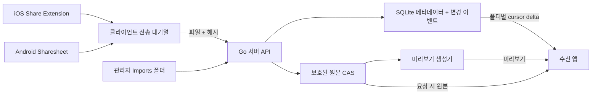

> **기록 보존:** 이 문서는 과거 PhotoHub 임시명으로 작성된 v1.2 문서입니다. 최신 프로젝트명은 **위드앨범(WithAlbum)**이며, v1.3 문서를 기준으로 진행합니다.

# PhotoHub 기획 및 아키텍처 정의서 v1.2

- 문서 날짜: 2026-10-17
- 상태: **개발 기준 초안**. 사용자가 확정한 UX와, 구현을 위해 추가 제안한 기술 설계를 구분한다.
- 제품명: PhotoHub는 임시 작업명이다.
- 근거: 사용자가 제공한 사진 공유 앱 기획 대화(초기 ~ v1.0 및 역방향 동기화 후속 논의).

## 1. 목표 및 사용자에게 약속할 것

**iOS + Android에서 사용자가 선택한 사진/동영상을 자신의 맥미니/NAS로 보내고, 참여자가 서로의 사진을 같은 공유 폴더에서 보며, 휴대폰에는 기본적으로 경량 미리보기를 보관하는 프라이빗 공유 갤러리.**

- 서버에 **원본 그대로** 저장한다. 해시 중복 제거는 바이트 수준에서 동일한 파일에만 적용한다.
- iCloud를 요구하지 않는다. 초기 서버는 Mac mini + 외장 스토리지, 이후 Linux / NAS / Docker 지원을 목표로 한다.
- 기본 Photos/Gallery 앱의 앨범을 자동 감시하거나 변경하지 않는다. **Share Sheet / Android Sharesheet**에서 사용자가 명시적으로 전송한다.
- 수동 **지금 동기화**를 1차 필수 기능으로, 자동 전송은 운영체제 허용 범위의 보조 기능으로 만든다.
- 앱의 임시 원본만 자동 정리한다. **기본 Photos/Gallery의 원본을 앱이 몰래 삭제하지 않는다**.
- 사용자 폰의 보관 옵션: `SMART_PREVIEW` (기본), `KEEP_ORIGINAL`.
- 로컬 저장소는 클라우드가 아니라 사용자의 장치이므로, **백업 장치가 없으면 단일 디스크 장애로 원본을 잃을 수 있다**. 성공 표시와 백업 완료 표시는 분리한다.

## 2. 확정된 UX 흐름

### 2.1 보내기(Outbound)

1. 사용자가 기본 사진/갤러리에서 사진·영상 여러 개 선택 → **공유** → PhotoHub 선택.
2. 공유 확장 화면에서 서버·목적지 공유 폴더 선택 → 가져오기 확인.
3. 원본 데이터를 앱의 임시 대기열에 안전하게 보관하고 `STAGED`로 기록한다. (가능한 경우 즉시 전송할 수 있으나 파일 복사를 완전히 피한다고 약속하지 않는다.)
4. 앱은 개수·용량·남은 공간·와이파이 여부를 표시한다.
5. **지금 동기화**를 누르거나 OS가 허용한 백그라운드 전송에서 업로드한다. 끊김 시 재시도/이어받기(후속 구현) 처리.
6. 서버가 원본 바이트 수·SHA-256·디스크 저장·DB 등록을 검증한 후에 성공 응답한다.
7. 폰은 서버 미리보기를 확보한 다음, `SMART_PREVIEW`일 때 앱의 스테이징 원본을 삭제하고 캐시만 유지한다. `KEEP_ORIGINAL`은 보존한다.
8. 기본 사진 앱의 원본은 사용자가 직접 관리한다. 삭제 유도는 서버 복제본 상태와 별도 백업 상태를 명확히 표시한 뒤 선택적으로 제공한다.

### 2.2 받기(Inbound)

1. 멤버가 사진을 업로드하거나, 관리자가 서버의 `Imports/<folder>/`에 파일을 둔다.
2. 서버가 해시·원본 저장·미리보기를 처리하고, 해당 폴더의 **증가하는 변경 시퀀스(seq)** 에 `asset_added`를 기록한다.
3. 앱이 열려 있으면 즉시 `GET /folders/{id}/sync?cursor=...` 호출. 서버는 SSE/WebSocket 또는 푸시로 **변경 가능성이 있음**을 힌트로 보낼 수 있다.
4. 앱은 이전 커서 이후의 이벤트를 순서대로 받고 `(folder_id, asset_id)`로 로컬 항목을 식별한다. 이때 자신이 업로드한 파일도 메타데이터는 반영한다. 이미 미리보기가 있으면 재다운로드만 생략한다.
5. 미리보기 파일이 아직 없다면 메타데이터를 먼저 보여주고 `PROCESSING` 상태로 표시한다. 네트워크/공간 상황에 따라 미리보기는 필요할 때 받는다.
6. 폴더에서 삭제된 항목은 `asset_removed` 묘비 이벤트를 반영한다. 삭제는 **폴더 연결만 해제**하며, 다른 폴더에서 사용하는 원본과 정책상 보존할 원본은 삭제하지 않는다.
7. 네트워크가 없거나 휴대폰이 꺼져도 서버가 이벤트를 보존한다. 앱 실행/재연결 때 커서를 기준으로 따라잡는다. 커서가 만료되면 전체 재동기화한다.

### 2.3 원본 보기

- 그리드: 미리보기(썸네일), 상세: 화면용 프리뷰, **원본 다운로드/내보내기**를 별도 버튼으로 제공한다.
- 핀치 확대 시 자동 원본 로드 여부는 데이터 사용/사용자 설정을 고려하는 UX 개선안이지 MVP 필수 사항이 아니다.
- 사진·영상 원본 내보내기 시 네트워크/서버 오프라인 오류를 명확히 표시한다.

## 3. 그림으로 본 데이터 흐름



## 4. 권장 구성요소

| 영역 | 기술 | 비고 |
|---|---|---|
| 모바일 공통 UI | Flutter | 공유 갤러리, 앨범·사용자·동기화 UI |
| iOS OS 통합 | Swift Share Extension + App Group + URLSession background | 공유된 임시 파일 수명 및 확장 종료 주의 |
| Android OS 통합 | Kotlin Activity/Intent + WorkManager | `content://` URI 권한·전송 큐 관리 |
| 서버 | Go | macOS/Linux용 API와 디스크 계층 분리 |
| 저장소 메타데이터 | SQLite (초기) | WAL, FK, 트랜잭션 및 무결성 검사 |
| 원본 | 외장디스크 내 CAS pool | 원본은 서버만 변경; SHA-256 기준 바이트 동일 파일 재사용 |
| 미리보기 | 별도 변환 작업 큐 | 이미지 HEIC/JPEG/RAW, 비디오 MOV/MP4 등은 각 코덱별 전략 필요 |
| 데스크톱 관리 | Web UI(초기), 네이티브 래퍼(후속) | 스토리지 연결, 원본 가져오기, 상태/로그/백업 |
| LAN | 로컬 HTTPS 또는 신뢰된 페어링 경로 | 개발용 HTTP 예외는 상용 배포 금지 |
| 외부 접속 | 후속 TURN/relay 또는 VPN형 연결 | NAT/인증/운영비/프라이버시 설계 후 진행 |

## 5. 스토리지 경계

```text
<storage-root>/
├── .system/                  # 애플리케이션 전용, 사용자가 직접 수정하지 않음
│   ├── pool/ab/<sha256>      # SHA-256 검증 완료 원본
│   ├── previews/ab/<sha256>.jpg
│   ├── incoming/             # 미완료 업로드 임시 파일
│   └── ...                   # 실제 제품: 작업 큐 및 미디어 인덱스
├── Imports/                 # 사용자가 Finder/NAS를 통해 이곳에 파일을 복사
│   └── <folder-id>/
└── Exports/                 # 읽기용/명시적 내보내기 결과물
```

원래 v1.0의 `SharedFolders/` 하드링크 노출안은 **변경**한다. 하드링크 대상 파일을 Finder에서 덮어쓸 경우 CAS 원본도 변형될 수 있어 불변성에 위배된다. `Imports`는 감시 폴더이되 복사 완료 감지(파일 크기 안정성·임시 확장자 제외·재시도), 디렉터리 탈출/심볼릭 링크 방어, 가져오기 실패 보관이 필요하다. `Exports`는 명시적으로 생성한 복사본 또는 읽기전용 스냅샷이다.

## 6. 엔티티 정의

- `users`, `devices`, `folders`, `folder_members` — 계정, 기기, 권한(OWNER/EDITOR/VIEWER).
- `blobs` — 파일 바이트와 SHA-256, 물리 경로, MIME, 크기, 검증 상태. 절대 원본 데이터의 관리 기준.
- `assets` — 유저가 인식하는 사진/영상 항목(ID), 원본 blob 참조, 촬영 시각, 가공 상태, Live Photo 쌍 연결 등.
- `folder_assets` — 어떤 폴더에 어떤 항목이 있는지 나타내는 논리적 연결.
- `folder_changes` — 폴더별 순차 증가하는 이벤트 기록(`asset_added`, `asset_removed`, `asset_updated`).
- `device_sync_cursors` — 폴더와 기기별 마지막 적용 seq(선택적 서버 저장; 클라이언트가 자체 저장 필수).
- `upload_sessions`, `idempotency_keys` — 나중에 추가될 대용량 전송/중복 요청 재처리.

**구분해야 할 아이덴티티:** `(blob_hash)`는 동일 바이트의 물리 데이터, `(asset_id)`는 앱 항목, `(folder_id, asset_id)`는 폴더에서의 구성, `(device_id, folder_id, seq)`는 수신 상태다. 하나의 `hash`로 전부 해결하지 않는다.

## 7. 동기화 계약

- 서버 seq는 **폴더별 정수**, 하나의 트랜잭션으로 이벤트와 폴더 변경을 기록한다.
- `GET /api/v1/folders/{folder_id}/sync?cursor=<N>&limit=100`은 `events`, `assets`, `next_cursor`, `has_more`를 반환한다.
- 변경 이벤트는 권한을 확인한 사용자에게만 공개한다. 서버는 현재 API 응답의 내용을 신뢰하지 말고 매 요청 토큰을 검증한다.
- 클라이언트는 **메타데이터/로컬 DB 적용이 성공한 뒤** 커서를 전진시킨다. 미리보기 캐시 다운로드는 별도의 재시도 가능 작업으로 두는 편이 안전하다.
- 앱을 다시 설치했거나 단말이 바뀌었을 때 서버의 **폴더 전체 스냅샷**에서 복구한다.
- 동일 파일이 **같은 폴더에 두 번 추가**되면 기본적으로 하나의 항목(중복 등록 방지). 사진 복사본/편집본/서로 다른 표시 메타데이터를 나중에 허용할 경우 별도 `asset_id` 정책이 필요하다.
- **권한 철회 시 기기 캐시**를 즉시 회수할 수 있다고 약속하지 않는다. 접근 차단과 다음 접속 때 정리하는 정책을 마련한다.

## 8. 삭제·보관·보안 정책

- 기본 사진 앱에 있는 사진 삭제는 항상 사용자 통제 하에 둔다.
- **앨범에서 제거**와 **서버에서 영구 삭제**는 다른 동작이며 영구 삭제는 별도 확인·휴지통·유예 기간을 거친다.
- 원본 삭제 전에는 다른 폴더가 참조하는지, 복구 기간이 남았는지 확인한다.
- 디바이스 연결은 QR 코드로 서버 공개 키/페어링 코드를 확인하고 짧은 수명의 토큰을 발급. 토큰 폐기·회전·권한 분리가 필요하다.
- 업로드는 크기 상한, 파일 타입/코덱 검사, 악성 페이로드 방어, 해시 검증, 디스크 잔량 검사, 경로 정규화를 포함한다.
- 스토리지 분리/가득 참/권한 오류/프로세스 재시작/네트워크 단절에도 원본 유실 없이 복구 가능한 상태 머신이 필요하다.
- 위치(EXIF GPS), 얼굴, 촬영 시각은 개인정보로 취급하고 공유 범위를 선택 가능하게 설계한다.
- 원본 1개 디스크 복사본은 **백업이 아니다**. 향후 독립 장치의 두 번째 백업과 복구 테스트를 지원한다.

## 9. 범위 / 릴리스 단계

### Phase 0 — 계약 및 POC (현재 제공 산출물)

- 기획 v1.2, API 초안, SQLite DDL, 동기화 상태 정의.
- **Go 로컬 POC**: 폴더 생성, SHA-256 서버 중복 제거, 파일 원본 저장, JPEG/PNG/GIF 이미지 JPG 프리뷰, 폴더 이벤트 증분 조회.
- POC는 보안·멀티 사용자·HEIC/비디오·재시도/청크·파일 시스템 감시가 없어서 배포용 제품이 아님.

### Phase 1 — 실제 로컬 MVP

- Go + SQLite DB, 인증, 온디스크 트랜잭션 복구, 폴더 권한, 업로드 idempotency, 썸네일 생성 작업 큐.
- Flutter 앱(앨범, 그리드, 동기화 버튼, 상태 표시, 원본/스마트 프리뷰 보관).
- LAN에서 iOS와 Android 각각 실제 사진/영상 100개·대용량 영상 테스트.

### Phase 2 — OS 공유 메뉴와 내결함성

- Swift Share Extension/App Group 및 Android ACTION_SEND(_MULTIPLE) 인입.
- 백그라운드 작업 등록과 재개, 디스크 부족, 연결 실패, 동시 업로드, 앱 강제 종료 검사.
- Live Photo/HEIC/HDR/RAW/4K 비디오 별도 호환성 검증.

### Phase 3 — 완전한 양방향 공유

- 폴더별 변경 큐·삭제 tombstone·권한·다중 기기·원본 다운로드.
- 수신 앱 프리뷰 캐시 정책, 푸시 힌트, 서버 Imports watcher, 관리자 UI.

### Phase 4 — 상용화

- macOS 인스톨러, Linux/NAS 패키징, 인증서·원격 네트워크 연결, 데이터 마이그레이션, 모니터링, 백업/복구, QA, 접근성 및 스토어 심사.

## 10. 검증이 필요한 가정과 기술 실험

1. 공유 시트에서 선택된 iCloud 최적화 항목/Live Photo 원본을 확보할 수 있는지, 사진 앱이 로컬에 원본을 내려받아야 하는 조건.
2. 앱 실행 중 수동 동기화 vs iOS 시스템이 자동 전송을 실제로 허용하는 범위, 데이터·배터리 사용과 네트워크 상태.
3. 영상 변환 및 HEIC/RAW/HDR 메타데이터·색상 보존, 미리보기 용량 목표의 현실성.
4. 느린 NAS, 외장하드 분리·읽기전용 전환, 디스크 포맷(APFS/exFAT 등)에 따른 안정성.
5. 가족 그룹 사용 시 실제 사용자가 요구하는 공유 권한, 앨범 정렬, 댓글·반응의 우선순위.

## 11. 우선순위가 낮아진 기존 아이디어

- iCloud 브릿지: **채택하지 않음**.
- 기본 사진 앱 특정 앨범을 감시하며 양방향으로 자동 삽입: **채택하지 않음**.
- 기본 사진 앱 썸네일과 원본을 iCloud처럼 시스템 수준에서 자동 스왑: **채택하지 않음**.
- 기본 사진 앱 내 아이템 강제 삭제 및 원본 변경: **채택하지 않음**.

## 12. 다음 작업의 완료 조건

첫 진짜 MVP가 완료됐다고 말하려면 **실제 아이폰 1대 + Android 1대 + Mac mini 저장소**에서 사진 1장과 큰 영상 1개가 각자 업로드되고, 상대방 기기에서 미리보기로 보이고, 원본을 다시 다운로드할 수 있으며, 동일 바이트 중복 업로드와 네트워크 장애 재시도에도 데이터가 유실되지 않아야 한다.
