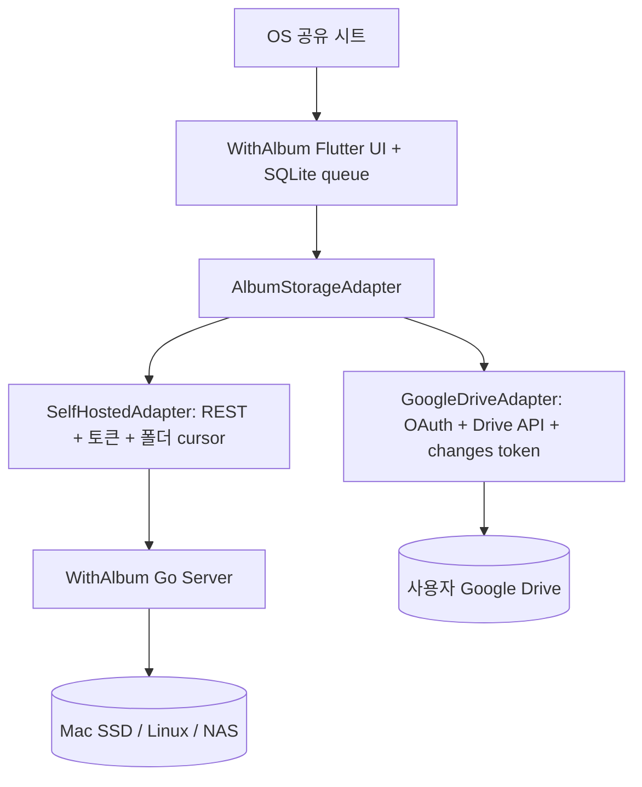

# 위드앨범 저장 백엔드 분리 원칙 v1.3

## 핵심 결정

Google Drive는 **Go 서버에 설치하는 플러그인만으로 만들지 않는다.** 서버가 없는 사용자도 쓸 수 있어야 하므로 모바일 앱의 Data/Sync 계층에 **독립적인 provider**를 둔다. 이 코드는 아직 목표 설계다.



## 클라이언트 인터페이스 (개념)

```text
AlbumStorageAdapter:
  listAlbums()
  getAlbum(albumId)
  uploadOriginal(albumId, item, onProgress, resumeState)
  listChanges(albumId, cursor)
  fetchPreview(item)
  downloadOriginal(item)
  removeFromAlbum(item)
  listCapabilities()
```

`listCapabilities()`는 provider 간 UX 차이의 기준이다. `supportsRealtime`, `supportsAtomicDedup`, `supportsCustomACL`, `supportsComments`, `supportsServerTranscoding` 같은 값을 사용한다. **백엔드가 지원하지 않는 기능은 저장 데이터나 버튼이 없는 척하지 말고 명시적 안내를 표시한다.**

## 중요한 구분

- Self-hosted: 모바일의 `SelfHostedAdapter`가 인증된 Go 서버의 API를 호출한다. 저장·해싱·변환은 Go 서버가 책임진다.
- Google Drive: 모바일의 `GoogleDriveAdapter`가 각 사용자의 OAuth 동의 아래 Drive API를 호출한다. 백그라운드 동기화는 OS 스케줄에 종속된다. Go 서버 설치는 필요 없다.
- 두 저장 방식을 동시에 연결할 수 있어도 **같은 앨범의 원본을 양쪽에 자동 이중 저장하지 않는다**. 복제/마이그레이션은 별도의 명시적 작업으로 만든다.
- 글로벌 사용자를 위한 계정/디렉터리 서비스는 나중에 선택할 수 있지만, Drive 모드를 위해 반드시 당장 도입해야 하는 것은 아니다. 다만 앱 고유의 댓글/좋아요/실시간 이벤트는 중재 서비스가 필요할 수 있다.

## 개발 우선순위 및 변경 규칙

1. 서버의 인증과 데이터 내구성을 완성하는 Mac-first 일정 유지.
2. 모바일 첫 버전부터 도메인 인터페이스를 분리해 Google Drive 지원을 추가하기 쉽게 한다.
3. Drive OAuth와 실제 다중 사용자 공유 PoC 통과 후 기능 등급을 최종 확정한다.
4. provider 데이터 보관, 알림 및 삭제 정책은 UI에서 분명히 구분한다.
5. API 권한은 최소 권한과 공개 앱 검증을 우선한다.

**현재 코드는 SelfHosted Go 서버의 인증 없는 로컬 PoC뿐이며, 위 인터페이스의 Flutter/Google Drive 구현은 없다.**


## v1.4 역할별 capability 주의

`listCapabilities()`는 `supportsUploadOnlyRole`을 포함한다. SelfHostedAdapter는 서버 ACL이 구현되고 검증되면 참, GoogleDriveAdapter(서버 없는 모드)는 거짓으로 둔다. Drive 권한을 앱 UI에서 숨기는 것으로 구현했다고 간주하지 않는다. 또한 `canCreateAlbum`은 server administrator가 계정에 부여한 별도 범위이며 storage provider별로 달라진다.
